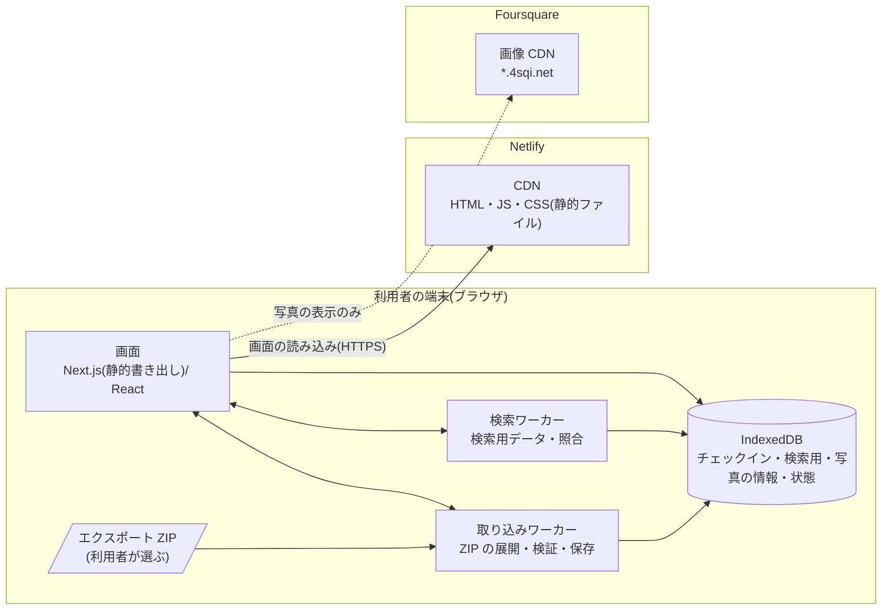

# 2. システム概要

> [基本設計書 目次](README.md) ｜ 前: [1. 前提条件・決定済み事項](01_前提条件.md) ｜ 次: [3. 技術調査の結果と方式決定](03_調査結果と方式決定.md)

---

## 2.1 システム構成

サーバーに送られるのは、画面のファイル(HTML・JS・CSS)を取得するリクエストと、写真を表示するときの Foursquare の画像 CDN へのリクエストだけである。取り込んだデータ、検索語、どのチェックインを見たかは、運営者のサーバーには送らない。ただし、検索式を含む URL はブラウザの閲覧履歴に残り、ブラウザの履歴の同期(Google・iCloud など)を有効にしている場合は同期先にも保存されることがある(9.5)。

## 2.2 構成要素と責務

| 構成要素 | 責務 | 備考 |
|---|---|---|
| 画面(UI) | 表示と入力、検索式の解析(liqe)、画面の状態(URL の `#` 以降)の管理、ワーカーとのやり取り、保存状態の確認(状態のストアの読み取り)、データベースの削除 | Next.js の静的書き出し。サーバー側の処理は無い |
| 取り込みワーカー | ZIP の目次の読み取り、必要なファイルの展開、レコードの検証と組み立て直し、既存データとの差分の算出、IndexedDB への保存 | 画面が固まらないよう別スレッドで動く |
| 検索ワーカー | IndexedDB から検索用のデータ(search_index)を読み込んでメモリに持ち、中間AST と照合して、該当件数と表示ページ分のチェックインを返す | 同上 |
| IndexedDB | チェックイン・検索用のデータ・写真の情報・取り込み状況の保存 | オリジンごと・ブラウザごとに別(iPhone・iPad では Safari とホーム画面のアプリでも別) |
| Netlify CDN | 静的ファイルの配信、セキュリティヘッダの付与 | |
| Foursquare の画像 CDN | 写真の画像の配信 | 本アプリからは画像の表示以外で接続しない |

## 2.3 基本方針

| No | 方針 | 狙い・対応要件 |
|---|---|---|
| P-1 | **データは端末の外に出さない**。取り込んだデータ・検索語・閲覧内容をサーバーに送らない。画面の状態は URL の `#` 以降(サーバーに送られない部分)に持つ。外部への通信は、写真の表示で Foursquare の画像 CDN に接続することだけにする | N-01、N-11 |
| P-2 | サーバー側の処理を持たない。静的なファイルの配信だけで動かす | 運用・費用・個人情報管理の最小化 |
| P-3 | 重い処理(ZIP の展開、検証、保存、検索)はワーカーで行い、画面を固めない | N-05、N-12 |
| P-4 | 必要最小限のデータだけを読む。ZIP からはチェックインと写真の情報だけを取り出し、それ以外(友人一覧、支払い・端末情報、訪問履歴、写真の実ファイルなど)は展開もしない。レコードからは許可した項目だけで raw を組み立て直す | N-11 |
| P-5 | raw を保存し、検索・表示用の値はいつでも raw から作り直せるようにする。エクスポートの形式は公式に文書化されておらず予告なく変わりうるため、取り込み処理は欠損や形の揺れを前提に書き、形式の判定と変換を1か所にまとめる | N-06 |
| P-6 | 読み込んだデータは信用しない。形式・長さ・範囲・件数を検証し、画面ではすべてテキストとして表示する。URL は読み込んだ値をそのまま使わず、検証した ID や許可したパターンから組み立てる | XSS の防止 |
| P-7 | **スクリプトを混入させない**ことを主対策とする(依存の最小化、第三者のスクリプト(解析・広告・外部 CDN)を一切読み込まない、配信経路の保護)。そのうえで CSP により、画面とワーカーからの通信先・画像の取得先を自サイトと画像 CDN に限り、持ち出しを難しくする。ただし画面の遷移・新しいウィンドウ・WebRTC などは CSP では止められないため、CSP だけで持ち出しを防げるとは考えない(10章) | N-13 |
| P-8 | 検索式は構造(中間AST)に変換してから照合し、文字列として評価・実行しない | N-10 |
