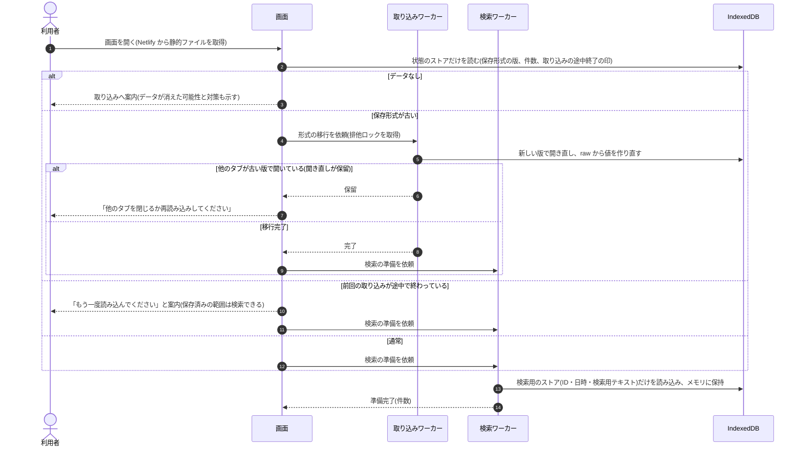
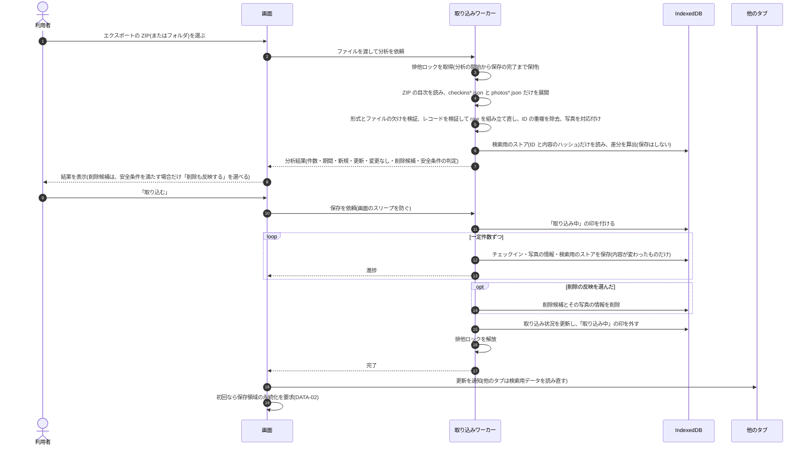
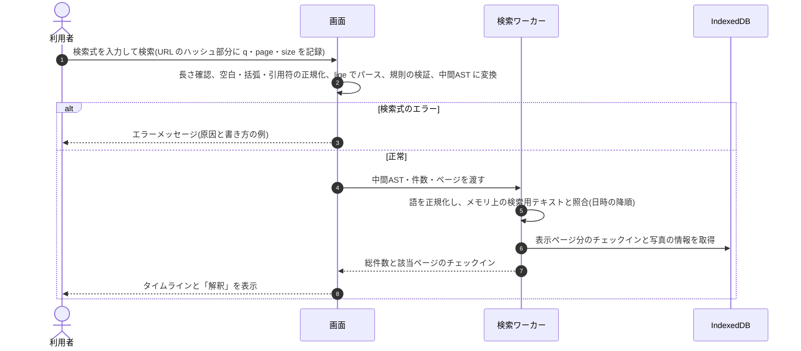
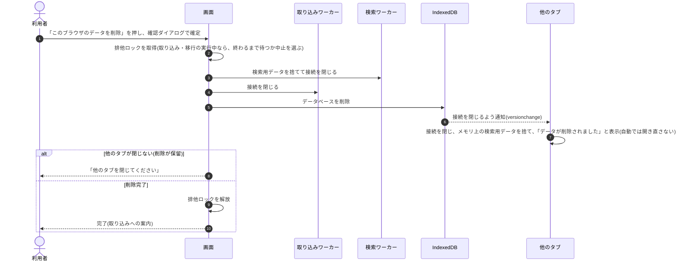

# 4. 機能設計

> [基本設計書 目次](README.md) ｜ 前: [3. 技術調査の結果と方式決定](03_調査結果と方式決定.md) ｜ 次: [5. 画面設計](05_画面設計.md)

---

## 4.1 機能一覧

| 機能ID | 機能名 | 概要 | 起動契機 | 対応要件 |
|---|---|---|---|---|
| IMPT-01 | エクスポートの申請案内 | エクスポートの申請手順(Swarm アプリ・Web)と、届くまでの目安を案内する。iPhone・iPad では、先にホーム画面に追加してそこから開くよう案内する | 取り込み画面、データ0件時 | F-16 |
| IMPT-02 | ファイルの読み込みと分析 | 選んだ ZIP(または展開済みのフォルダ・JSON)から `checkins*.json` と `photos*.json` だけを取り出し、検証して、既存データとの差分(新規・更新・変更なし・削除候補)を算出する。この段階では保存しない | 取り込み画面でファイルを選択 | F-10, F-12, N-11, N-12 |
| IMPT-03 | 保存 | 分析結果を確認した利用者の操作で、チェックインと写真の情報を保存する。削除候補は、安全条件を満たし、利用者が反映を選んだ場合だけ削除する。進捗を表示する | 「取り込む」ボタン | F-10, F-11, F-12, F-13 |
| IMPT-04 | 取り込みエラー処理 | 形式の不一致・保存領域の不足などの原因と対処を表示し、やり直せるようにする | 取り込み中のエラー | F-14 |
| SRCH-01 | チェックイン検索 | 検索式を解析・検証し、ブラウザ内で照合する。総件数と表示ページ分のデータを返す | 検索画面での検索・ページ移動 | F-20〜F-26, N-05, N-10 |
| SRCH-02 | 検索結果表示 | タイムライン表示、件数表示、ページネーション、該当なし表示、検索条件の解釈表示 | 検索結果の受信 | F-24, F-30, F-31 |
| DETL-01 | チェックイン詳細 | 保存データ(写真を含む)を表示し、Foursquare 上の店ページへのリンクを示す | 一覧の1件をクリック | F-33 |
| DATA-01 | 保存状況の表示 | 保存件数、最新チェックインの日時、最終取り込み日時、保存領域の状態(永続化の有無、使用量)を表示する | データ管理画面、ヘッダー | F-04, F-17 |
| DATA-02 | 永続化の要求 | 取り込みの完了時に、ブラウザに保存領域の永続化を求め、結果を表示する | 初回の取り込み完了時、データ管理画面 | F-17 |
| DATA-03 | データの削除 | このブラウザに保存したデータをすべて即時に削除する | データ管理画面 | F-03, F-40 |
| APP-01 | 起動時の確認 | 保存データの有無・保存形式の版・前回の取り込みが途中で終わっていないかを確認し、必要なら案内や形式の移行を行う | 画面を開いたとき、bfcache から復帰したとき | F-17, N-06 |
| APP-02 | タブ間の調整 | 同じブラウザの複数のタブで、取り込み・削除・形式の移行が同時に走らないようにし、完了後に他のタブの表示を更新する | 取り込み・削除・移行の開始と完了 | — |
| DEV-01 | ローカル開発環境・テスト用データ | `next dev` での開発、架空データの fixture と疑似エクスポートの生成 | 開発者の操作 | L-01, L-02, L-05 |

## 4.2 処理の流れ

### 4.2.1 起動と検索の準備 — APP-01

### 4.2.2 エクスポートの取り込み — IMPT-01〜04

### 4.2.3 検索 — SRCH-01 / SRCH-02

### 4.2.4 データの削除 — DATA-03

