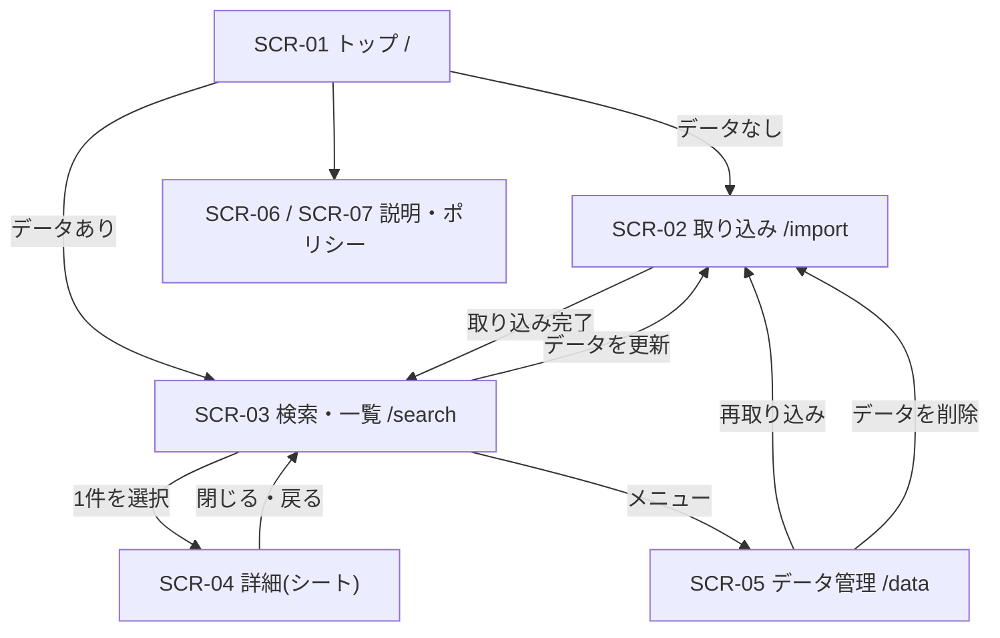

# 5. 画面設計

> [基本設計書 目次](README.md) ｜ 前: [4. 機能設計](04_機能設計.md) ｜ 次: [6. データ設計](06_データ設計.md)

---

## 5.1 画面一覧

| 画面ID | 画面名 | URL | 概要 | 主な機能 |
|---|---|---|---|---|
| SCR-01 | トップ | `/` | アプリの説明と使い方。保存データがあれば検索画面へ進む | APP-01 |
| SCR-02 | 取り込み | `/import` | エクスポートの申請案内、ファイル選択、分析結果、進捗、完了 | IMPT-01〜04, DATA-02 |
| SCR-03 | 検索・一覧 | `/search` | 検索ボックス、解釈、件数、タイムライン、ページネーション | SRCH-01, SRCH-02 |
| SCR-04 | チェックイン詳細 | `/search` 上のシート | 保存データと写真。PC は一覧の右側、スマホは全画面 | DETL-01 |
| SCR-05 | データ管理 | `/data` | 保存状況、保存領域の状態、データの更新(再取り込み)、データの削除 | DATA-01〜03 |
| SCR-06 | このアプリについて | `/about` | 非公式アプリである旨と商標の免責文、使い方、できること・できないこと、よくある質問 | — |
| SCR-07 | プライバシーポリシー | `/privacy` | 9.5 に挙げる記載事項 | N-11 |
| SCR-E | エラー | 各画面 | 対応していないブラウザ、保存領域が使えない(IndexedDB を開けない場合)、他のタブでデータが削除された、404 | — |

ログインが無いため、ログイン・利用同意・マイページの画面は無い。

## 5.2 画面遷移



- 検索画面・データ管理画面を開いたときに保存データが無い場合は、取り込み画面へ案内する(ブラウザのデータが消えた可能性がある場合は、その旨と、Safari での対策も示す)。

## 5.3 共通レイアウト

| 領域 | 内容 |
|---|---|
| ヘッダー | アプリ名(`/search` へのリンク)、データの鮮度(「最新チェックイン 10/14・取り込み 10/16」)と「データを更新」リンク、メニュー(データ管理・このアプリについて) |
| メイン | 1カラム。本文の最大幅は約 768px |
| フッター | 「データはこの端末の中だけに保存され、送信されません」の一文、非公式アプリである旨と商標の免責文、このアプリについて・プライバシーポリシーへのリンク |
| レスポンシブ | スマホ優先で設計。ブレークポイントは sm 640px / md 768px / lg 1024px(Tailwind 標準) |

## 5.4 画面別の概要

以下のワイヤーフレームは配置のイメージであり、寸法や文言は詳細設計で確定する。

### SCR-01 トップ

```text
[ロゴ] Houmon_Mania
-----------------------------------------------------------
  Swarm のチェックイン履歴を、
  店名やコメントで検索できます。

  [ はじめる ]   (データがある場合は [ 検索する ])

  iPhone・iPad をお使いの場合: 先にこのページをホーム画面に追加し、
  ホーム画面のアイコンから開いて読み込んでください
  (Safari で読み込んだデータは、ホーム画面から開いたアプリでは見えません。
   ホーム画面から使うと、データが消えにくくなります)

  使い方
  1. Swarm の設定から、データのダウンロードを申請します
     (数日でメールが届きます)
  2. 届いた ZIP ファイルを、このアプリで読み込みます
  3. 店名・コメントで検索できます

  ・データはこの端末の中だけに保存されます。サーバーには送りません
  ・ログインは不要です
  ・できないこと: 住所・カテゴリでの検索、自動での更新、
    別の端末とのデータの共有
-----------------------------------------------------------
このアプリについて | プライバシー
本アプリは Foursquare / Swarm の公式アプリではありません
```

### SCR-02 取り込み

```text
データの取り込み

1. エクスポートを申請する(まだの場合)
   Swarm アプリ: プロフィール → 設定 → プライバシー設定
     → 「Initiate Data Download Request」
   Web: foursquare.com → Settings → Privacy Settings → 同上
   通常2〜3日(最大7日)で、ダウンロード用のリンクがメールで届きます。

   (iPhone・iPad: Safari で開いている場合は、先にホーム画面に追加し、
    ホーム画面のアイコンから開き直してから読み込んでください)

2. 届いた ZIP ファイルを選ぶ
   [ ZIP を選択 ]  [ 展開済みのフォルダを選択 ]
   (ZIP のまま選べます。写真が入っていて大きくても大丈夫です)
   ※ ファイルはこの端末の中で読み込みます。送信はしません
   ※ 共有のパソコンでは使わないでください(同じブラウザを使う人が見られます)
   ※ プライベートブラウズでは、ウィンドウを閉じるとデータが消えます

(分析後)
   チェックイン 14,265 件(2011/04/02 〜 2026/10/14)・写真の情報 3,120 件
   新規 120 件 / 更新 3 件 / 変更なし 14,142 件
   今回のエクスポートに含まれていないもの 2 件(Swarm で削除された可能性)
     [ ] これらを削除する
   [ 取り込む ]

(取り込み中)
   [■■■■■■■■■■■□□□□□□□]  58%   8,250 / 14,265 件
   ※ 終わるまでこの画面を開いたままにしてください
     (他のアプリに切り替えたり画面をロックしたりすると中断します)

(完了)
   取り込みが完了しました。          [ 検索をはじめる ]
   データを消えにくくする設定: 許可されました / 許可されていません
   (Chrome は利用状況から自動で判断するため、始めは「許可されていません」に
    なることがあります。異常ではありません)
```

- 削除候補は、安全条件(9.2.4)を満たす場合だけ「これらを削除する」を表示する(既定はオフ)。満たさない場合は、件数と「完全なエクスポートを読み込むと反映できます」という案内だけを表示する。
- 取り込み中は、対応するブラウザでは画面のスリープを防ぐ(Screen Wake Lock)。
- macOS の Safari はダウンロードした ZIP を自動で展開することがあるため、展開済みのフォルダも選べるようにする(9.2.2)。

### SCR-03 検索・一覧(PC)

```text
[ロゴ] Houmon_Mania        最新チェックイン 10/14・取り込み 10/16 [データを更新]  (メニュー)▼
-------------------------------------------------------------------------------
 [ 一蘭 OR (ラーメン 渋谷)                               ] [検索] [?]
 [▼ 詳細条件 (指定あり)                                                    ]
   チェックイン日      [yyyy/mm/dd] 〜 [yyyy/mm/dd]
   曜日                [日][月][火][水][木][金][土]
   時間帯(現地時刻)  [18時▼] 〜 [23時台▼]
   写真 [あり▼]  コメント [すべて▼]  イベント [すべて▼]  公開範囲 [すべて▼]
   同じ店への訪問回数  [  3 ] 〜 [    ] 回                (条件をすべて解除)
 解釈: 一蘭 OR (ラーメン AND 渋谷)
 絞り込み: 18時〜23時台、写真あり、同じ店に3回以上
 1,234件中 201–250件                                          表示件数 [50▼]

 2026年10月
  ● 10/14(火) 19:32
  │  一蘭 渋谷店                                                   写真 2枚
  │  「替え玉2回」
  │
  ● 10/12(日) 12:05                                               親しい友達
  │  ブルーボトルコーヒー 渋谷カフェ
  │
 2026年9月
  ● 09/30(火) 08:10
     JR 渋谷駅

                    ‹ 前へ   1 … 4 [5] 6 … 25   次へ ›
-------------------------------------------------------------------------------
 データはこの端末の中だけに保存されています | このアプリについて | プライバシー
```

### SCR-03 検索・一覧(スマホ)

```text
[ロゴ]          [更新] (メニュー)
[ 一蘭 OR (ラーメン 渋谷) ] [検索]
1,234件(201–250件)       [50▼]

2026年10月
● 10/14(火) 19:32
│ 一蘭 渋谷店 · 写真 2枚
│ 「替え玉2回」
│
● 10/12(日) 12:05
│ ブルーボトルコーヒー 渋谷カフェ

        ‹    5 / 25    ›
```

| 表示項目(1件) | 内容 | 要件 |
|---|---|---|
| 日時 | 現地時刻の「MM/DD(曜) HH:mm」。年は月見出しに表示 | F-30 |
| 店名 | venue の名前。venue が無い場合は場所名、イベントならイベント名、それも無ければ「(場所なし)」 | F-30 |
| コメント(shout) | 2行で省略 | F-30 |
| 写真枚数 | 1枚以上のときだけ「写真 n枚」を表示 | F-30 |
| 公開範囲 | 「非公開」「親しい友達」のときだけ小さく表示 | F-30 |

- 月見出しは、ページ内で連続する同じ「年月」(現地時刻基準)ごとに付ける。タイムゾーンの違いで同じ月が離れて現れた場合は、見出しを重ねて表示する。
- 状態ごとの表示: 検索用データの準備中はスケルトン。該当なし(F-31)は「『〇〇』に一致するチェックインはありませんでした」と検索のヒント(店名・コメント・場所名・イベント名が検索対象で、住所・カテゴリは対象外であることも示す)。検索式のエラーは検索ボックス直下に、原因と正しい書き方の例を表示する。前回の取り込みが途中で終わっている場合は、再読み込みを促す。最終取り込みから30日以上たっている場合は、エクスポートの再申請を促す控えめな案内を出す。
- 「?」ボタンで検索構文のヘルプ(9.3.1 の表と例)を表示する。
- 「詳細条件」(折りたたみ)で絞り込む。条件は検索式と AND で組み合わせ、検索式が空でも使える。条件を変えるとすぐに 1 ページ目から検索し直す(入力中に履歴が増えないよう、URL は置き換える)。条件は URL の # 以降に持ち(`from`・`to`・`wd`・`hf`・`ht`・`photo`・`shout`・`event`・`vis`・`vmin`・`vmax`)、再読み込み・戻る・ブックマークで再現する。条件付きで開いたときは折りたたみを開いて表示する。
  - 日付・曜日・時間帯は、チェックインした場所の現地時刻で判定する(一覧の表示と同じ)。時間帯は両端の時台を含み、始まりが終わりより遅ければ日をまたぐ(例: 22時〜3時台)。
  - 同じ店への訪問回数は、保存しているチェックイン全体で venue ID ごとに数える(検索式や他の条件では数え直さない)。店の無いチェックインは、この条件を指定すると対象外になる。
  - カテゴリ・タグはエクスポートに含まれないため、条件にできない。
- 検索ボックスは入力の自動補完を無効にする(`autocomplete="off"`。共有端末で検索語が候補として残らないようにする)。

### SCR-04 チェックイン詳細

```text
(PC: 一覧の右側にシート / スマホ: 全画面)
✕ 閉じる
一蘭 渋谷店
2026年10月14日(火) 19:32(現地時刻 UTC+9)
「替え玉2回」
[写真] [写真]
公開範囲: 公開 · コメント 1件
Foursquare で店を見る ↗
```

- 保存データだけで表示する。
- 写真は、検証済みの画像 URL(9.4)を `` で表示する。表示できない場合(非公開写真、オフラインなど)は代わりの表示にする。
- 「Foursquare で店を見る」は、検証済みの venue ID から `https://foursquare.com/v/{venue_id}` を組み立てたリンク。住所やカテゴリはリンク先で確認してもらう。
- 開くと URL の `#` 以降に詳細の ID を加え、閉じる(または戻る)と一覧の同じスクロール位置に戻る。

### SCR-05 データ管理

```text
データ管理

このブラウザに保存しているデータ
  チェックイン 14,265 件 / 写真の情報 3,120 件
  最新チェックイン 2026/10/14 / 最終取り込み 2026/10/16
  使用量 約 18 MB
  データを消えにくくする設定: 許可されました / 許可されていません [ 許可を求める ]
  [ データを更新する(エクスポートを読み込み直す) ]

データの削除
  [ このブラウザのデータを削除 ]  → 確認ダイアログ
  ※ 削除しても、エクスポートを読み込み直せば元に戻せます
  ※ ブラウザの閲覧履歴(検索式を含む URL)と画像のキャッシュは、この操作では消えません。
    共有の端末では、ブラウザの履歴とキャッシュも削除してください
```

## 5.5 UI デザイン方針(タイムライン型)

| 項目 | 方針 |
|---|---|
| コンセプト | 「自分の足跡をたどる日記」。縦のタイムラインで時間の流れを、軽い区切りで1件ずつを見せる |
| レイアウト | 1カラム中心。詳細は PC では一覧を残したまま右側のシートで、スマホでは全画面で表示する |
| 配色 | ニュートラル(グレー系)とアクセント1色(暖色のオレンジ系)。Swarm/Foursquare のロゴやブランドカラーは使わず、非公式アプリであることを明確にする |
| ダークモード | OS の設定に追従する(CSS の `prefers-color-scheme`)。手動切替は MVP では設けない |
| 文字 | Web フォントは使わず、システムフォントを使う。指定順は Hiragino Sans、Hiragino Kaku Gothic ProN、Noto Sans JP、Noto Sans CJK JP、Meiryo、sans-serif(`system-ui` は先頭にしない)。本文 16px 相当 |
| アイコン | lucide-react |
| コンポーネント | shadcn/ui(既定の Base UI 版)を使い、独自 CSS を最小限にする。通知は Base UI 版の toast |
| 状態表現 | 準備中・読み込み中はスケルトン、処理中のボタンはスピナー付きで無効化、完了通知はトースト、エラーはその場にインライン表示 |
| 安心感の表示 | 「データはこの端末の中だけ」「送信しません」をトップ・取り込み画面・フッターに明示する |
| アクセシビリティ | WCAG 2.2 AA 相当を目標。コントラスト比 4.5:1 以上、キーボード操作、フォーカスの可視化、件数・取り込み進捗の読み上げ(aria-live)、ページネーションの `aria-current`。意味を持つアイコンにはラベルを付ける |
| 文言 | です・ます調で短く具体的に。エラーは「何が起きたか」と「どうすればよいか」をセットで示す |
| 読み込んだ値 | 店名・コメント(shout)などは、すべてテキストとして表示する。HTML として挿入しない。制御文字と双方向制御文字(U+202E など)は表示の前に取り除き、文字の並びを偽装できないようにする。リンクや画像の URL は読み込んだ値をそのまま使わず、検証した ID や許可したパターンから組み立てる(9.4) |

## 5.6 ページネーション方針

| 項目 | 方針 |
|---|---|
| 方式 | ページ番号式(総件数と任意のページへの移動)【決定】 |
| 画面の状態 | **URL の `#` 以降**に持つ。例: `/search#q=一蘭&page=5&size=50`(詳細を開いているときは `&id=…` を加える)。`#` 以降はサーバーに送られないため、検索語がサーバーのログに残らない(P-1)。検索式を変えたら page=1 に戻す。戻る/進む・ブックマーク・再読み込みで同じ結果を再現する(同じブラウザ内)。読み取りと更新の方法は 8.1 |
| 検索の送信 | 明示的な送信(Enter または検索ボタン)のみ。入力中の自動検索はしない |
| 表示件数 | 20 / 50(既定) / 100 |
| ページ番号の表示 | PC は「‹ 前へ 1 … 4 [5] 6 … 25 次へ ›」(最大7枠)、スマホは「‹ 5 / 25 ›」 |
| 範囲外の指定 | 最終ページに補正する(0件なら1ページ目)。不正な値は既定値にする |
| 件数表示 | 「1,234件中 51–100件」 |
| ページ移動時 | 一覧の先頭へスクロールする |
| 並び順 | 日時の降順で固定(F-24)。同時刻は ID の降順で並べ、ページ間で順序が揺れないようにする |
