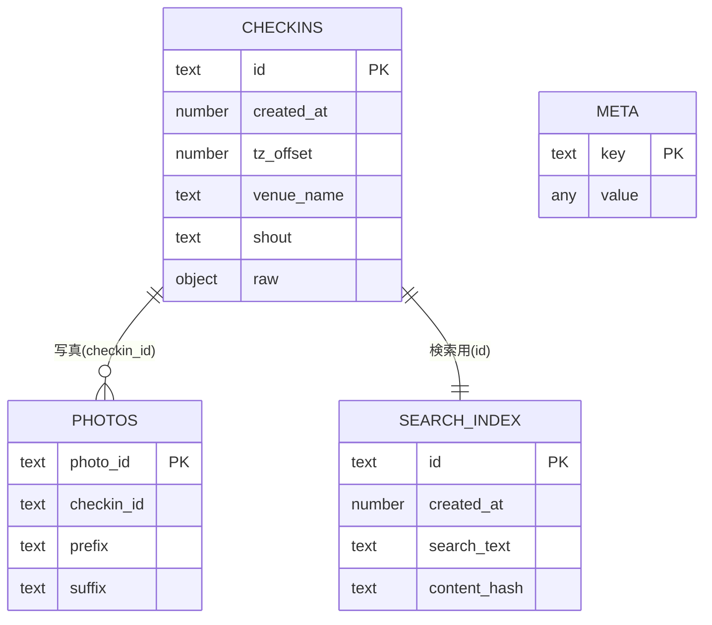
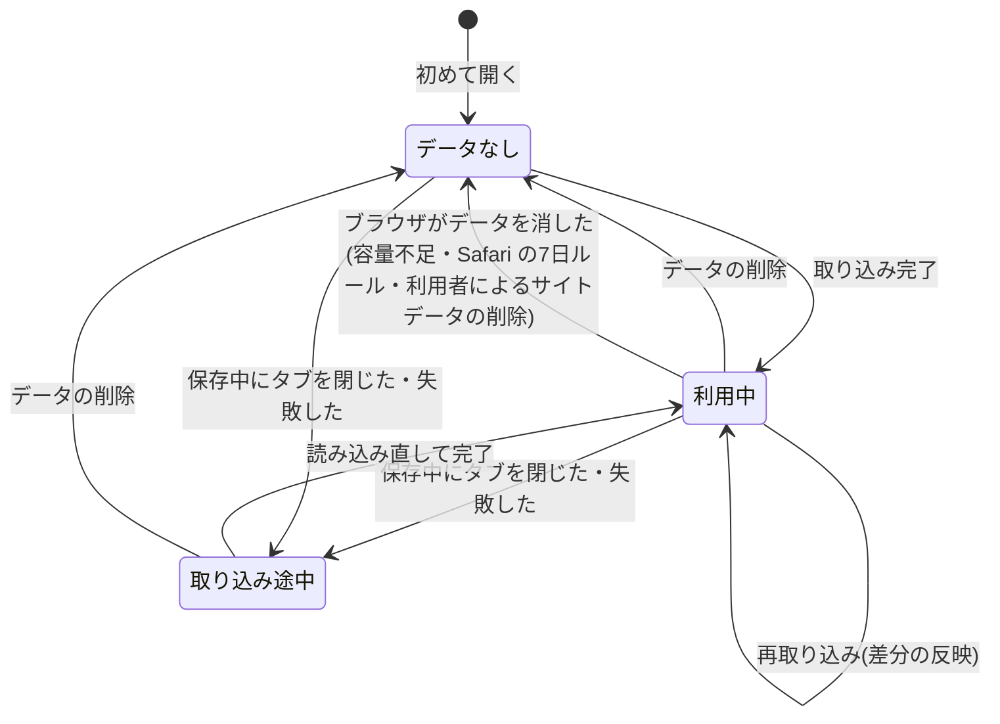

# 6. データ設計

> [基本設計書 目次](README.md) ｜ 前: [5. 画面設計](05_画面設計.md) ｜ 次: [7. インタフェース設計](07_インタフェース設計.md)

---

データはすべて利用者のブラウザの IndexedDB に保存する。サーバー側のデータベースは無い。保存形式の最終値(インデックス・項目の上限値)は詳細設計書で確定する。

## 6.1 保存の構成

| ストア | 概要 | キー | 主なインデックス |
|---|---|---|---|
| `checkins` | チェックイン(一覧・詳細の表示用、raw を含む) | id | created_at(並び替え用) |
| `search_index` | 検索と差分の算出に使う最小限の値(ID・日時・検索用テキスト・内容のハッシュ)。チェックインと1対1 | id | — |
| `photos` | チェックインに付いた写真の情報 | photo_id | checkin_id |
| `meta` | 保存形式の版、取り込み状況、取り込み中の印など | key | — |

検索の準備と取り込みの差分の算出は `search_index` だけを読む。raw を含む `checkins` を全件読まないので、件数が多くても読み込みの量とメモリを抑えられる。`checkins` と `search_index` と `photos` は同じトランザクションで書き込み、食い違いが生じないようにする。

- データベースは本アプリのオリジン(ドメイン)ごと・ブラウザごとに別で、他のサイトからは読めない。iPhone・iPad では、Safari で開いたときとホーム画面に追加したアプリから開いたときでも保存領域が別になる【暫定 S-7】。
- ログインが無いため、データの持ち主の区別は「どのブラウザに保存されているか」で決まる。旧版の要件にあった RLS(利用者ごとのデータ分離)は、ブラウザの保存領域の分離に置き換わった(要件 N-01)。

## 6.2 主要な項目

### checkins(チェックイン)

| 項目 | 内容 | 抽出元(チェックインレコード) | 欠損・不正時 |
|---|---|---|---|
| id | チェックインID(キー) | id(24桁の16進数) | 取り込まない |
| created_at | チェックイン日時(UTC、ミリ秒) | createdAt(UTC の文字列 `YYYY-MM-DD HH:MM:SS.ffffff`、または UNIX 秒の整数)。2009-01-01〜現在+1日の範囲 | 取り込まない |
| tz_offset | 現地時刻との差(分) | timeZoneOffset(−720〜840) | null(UTC で表示) |
| type | checkin / venueless / shout など | type | 'checkin' |
| visibility | 公開範囲(public / private / closeFriends など) | visibility(無ければ private:true → private) | null |
| shout | コメント | shout | null |
| venue_id, venue_name | venue の ID と名前 | venue.id(24桁の16進数)/ venue.name | null |
| location_name | 場所名(venue の無いチェックイン) | location.name | null |
| lat, lng | 緯度・経度(含まれている場合のみ) | location.lat/lng、またはトップレベルの lat/lng【暫定 S-1】。範囲を検証 | null |
| event_name | イベント名 | event.name | null |
| photo_count | 写真枚数 | 写真の情報から数える | 0 |
| comment_count | コメント数 | comments.count | 0 |
| raw | 許可した項目だけで組み立て直したチェックインレコード(1件 16KB 以下。UTF-8 のバイト数で数える) | — | 必須 |

文字列の長さには上限を設け(店名・場所名・イベント名 500文字、コメント 2,000文字など。値は詳細設計で確定)、超えるレコードは切り詰めずに不正として扱う。

### search_index(検索用)

| 項目 | 内容 |
|---|---|
| id | チェックインID(キー) |
| created_at | チェックイン日時。検索結果を新しい順に並べるために持つ |
| search_text | 検索用の正規化テキスト。店名・コメント(shout)・場所名・イベント名を改行で連結し、NFKC 正規化と小文字化をしたもの(9.3.3) |
| content_hash | raw と、そのチェックインの写真の情報の集合から計算したハッシュ。再取り込みのとき、これが同じなら「変更なし」とする(9.2.4) |

### photos(写真の情報)

| 項目 | 内容 |
|---|---|
| photo_id | キー |
| checkin_id | 対応するチェックイン。写真の情報の relatedItemUrl の末尾から取り出す。チェックインに対応しない写真は取り込まない |
| prefix, suffix, width, height | 画像 URL の組み立てに使う値。prefix と suffix は許可したパターン(9.4)に一致するものだけを保存する |
| visibility, created_at | 公開範囲、撮影・投稿日時 |

写真は、取り込んだチェックインごとに今回の集合で置き換える(Swarm で削除された写真が残らないようにするため)。

### meta(状態)

| キー | 内容 |
|---|---|
| schema_version | 保存形式の版。版が古ければ起動時に移行する(9.1.3) |
| last_imported_at | 最後に取り込みが完了した日時 |
| latest_checkin_at | 保存済みの最新チェックインの日時(取り込み・削除の完了時に再計算) |
| period_min, period_max, checkin_count | 保存データの期間と件数 |
| last_import_summary | 直近の取り込みの件数(新規・更新・変更なし・削除・不正)と、読み込んだファイル名の一覧(内容は含めない) |
| import_in_progress | 取り込みの保存中であることを示す印。保存の開始時に付け、完了時に外す。起動時に残っていれば、途中で終わったと判断する |
| persist_requested_at | 永続化を最後に求めた日時 |

## 6.3 データのライフサイクル

ブラウザがデータを消した場合、アプリからは「データなし」に見える。起動時に「以前は保存されていた」ことを確かめる手段は無いため、データなしの状態ではいつも、消えた可能性とその対策(ホーム画面への追加、永続化の許可)も案内する。

## 6.4 データ量の見積り

| 項目 | 見積り |
|---|---|
| 1件あたり | 約 0.6〜1.2KB(checkins の raw、search_index、写真の情報、インデックスを含む見込み) |
| 5万件 | 約 30〜60MB |
| 20万件(上限) | 約 120〜240MB |
| 検索ワーカーのメモリ | search_index の値(ID・日時・検索用テキスト)だけを持つ。5万件で約 10〜20MB、20万件で約 40〜80MB の見込み |

ブラウザの保存領域は通常これより十分大きい(端末の空き容量の一定割合)。実機での確認は S-6・S-7 で行う。
