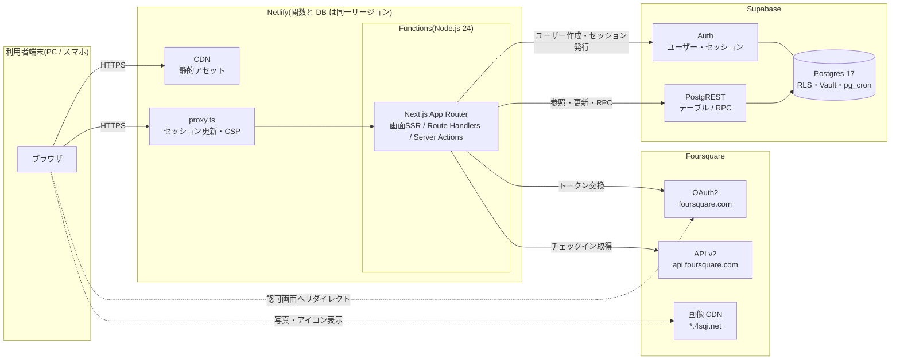
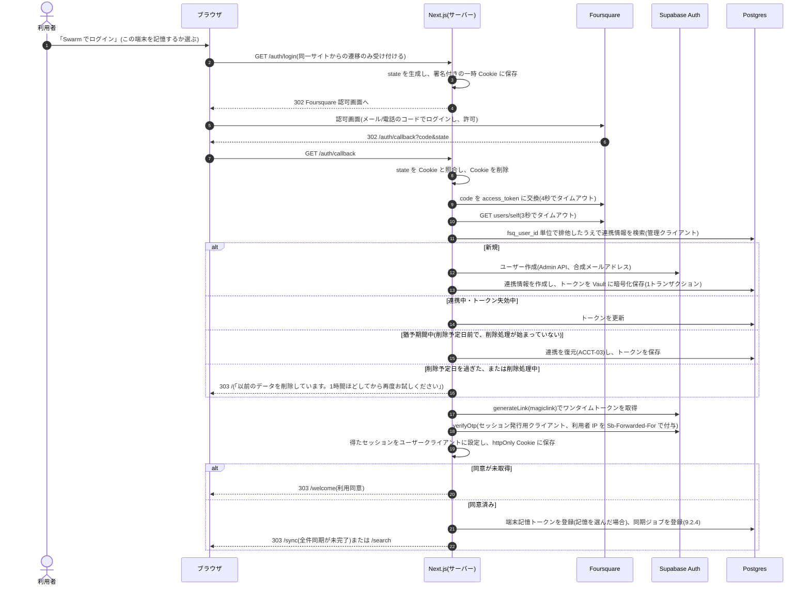
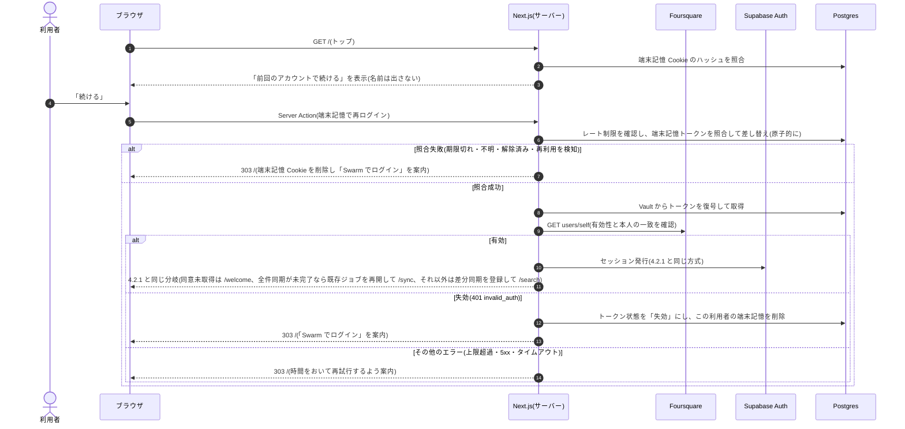
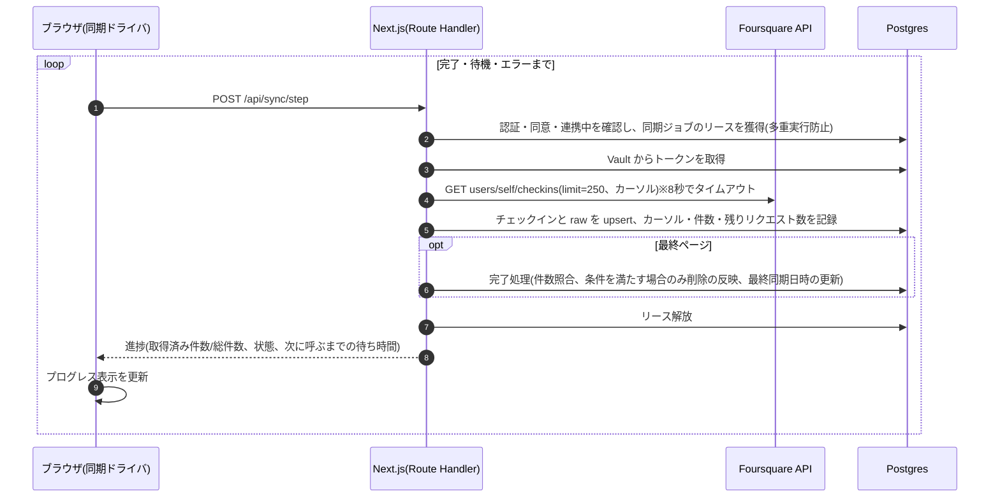
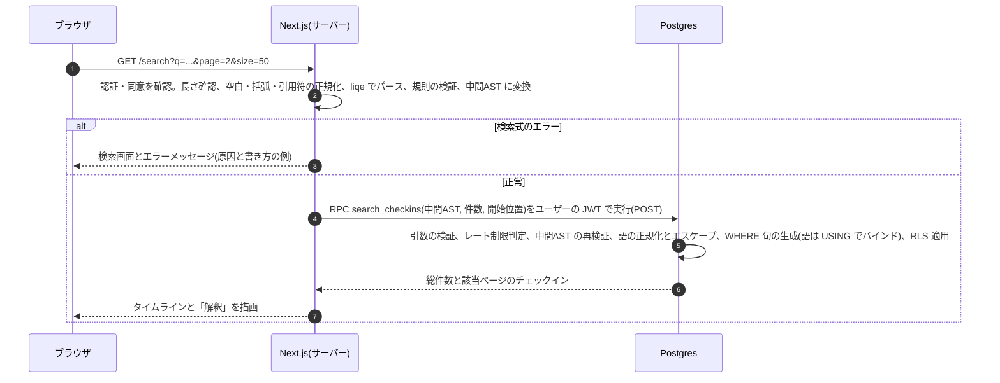
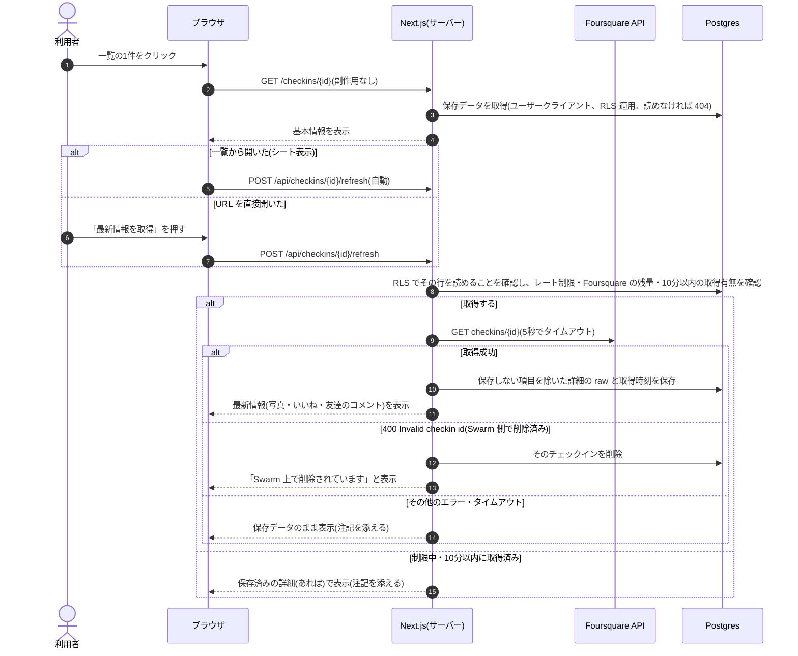
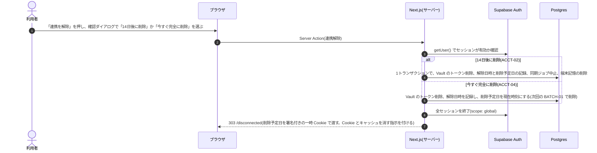
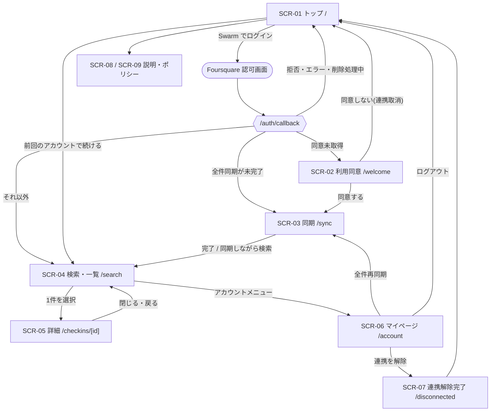
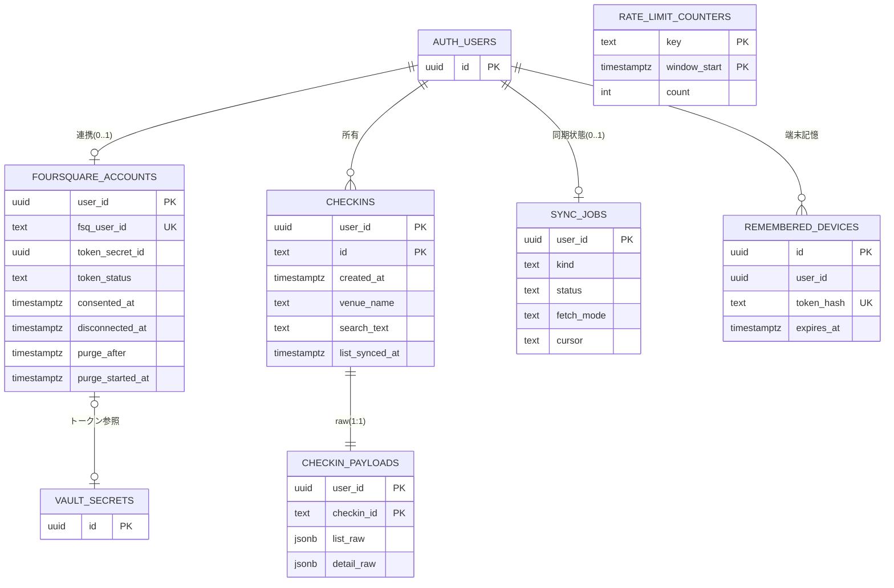
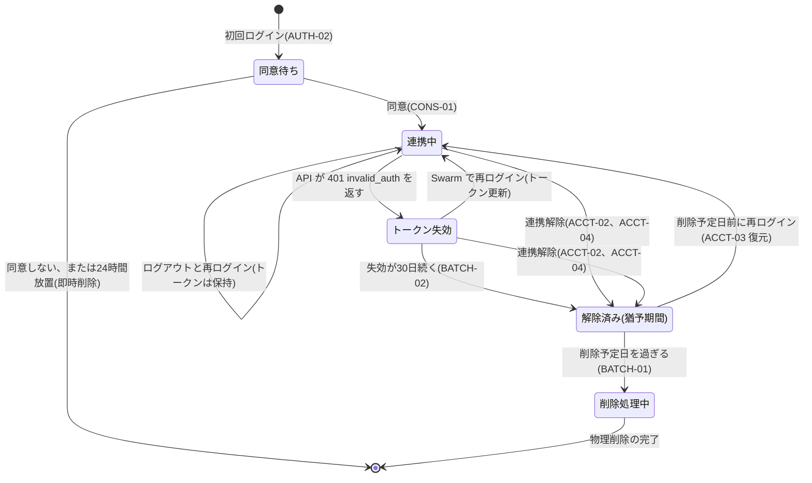

# 基本設計書:Swarmチェックイン検索アプリ(MVP)【旧版・API 同期方式】

> **この版は廃止済みです。** 2026-10-16 に、Foursquare API の利用ガイドライン(サーバー保存の禁止)を受けて、データ取得方式を「公式データエクスポートのアップロード」に変更しました。最新版は `doc/2_basic design.md` を参照してください。本書は、API 方式で検討した内容の記録として残しています。

| 項目 | 内容 |
|---|---|
| 版 | 0.9(レビュー提出版) |
| 作成日 | 2026-10-16 |
| ステータス | レビュー待ち(要判断事項は17章) |
| 前提文書 | `doc/1_requirements definition.md`(要件定義書) |
| 関連文書 | `doc/2-1_technical investigation.md`(技術調査報告書)、`doc/3_detailed design.md`(詳細設計書・作成予定) |

### 改訂履歴

| 版 | 日付 | 内容 |
|---|---|---|
| 0.1 | 2026-10-16 | ドラフト(技術調査の反映前) |
| 0.9 | 2026-10-16 | 技術調査の結果を反映。要件網羅・セキュリティ・事実整合の3観点のレビュー指摘を反映 |

---

## 0. 本書の位置づけ

本書は要件定義書を受けて、システムを「どう実現するか」の方式を定める。

| 区分 | 内容 |
|---|---|
| 本書の範囲 | システム構成、機能構成、画面構成・画面遷移・UI方針、論理データ設計、外部/内部インタフェース概要、主要処理方式(認証・同期・検索・詳細取得・データ保持)、セキュリティ、非機能、開発・運用環境、技術スタックの確定 |
| 範囲外(詳細設計書で扱う) | テーブル物理設計(DDL・型・インデックス・制約の最終値)、API の入出力項目定義、画面項目定義・コンポーネント設計、メッセージ/エラーコード一覧、例外分岐を含む詳細シーケンス、テスト設計 |

要件定義書の「着手事項(検証1〜7)」は、本書の作成前に机上調査とローカル実験として実施し、結果を技術調査報告書にまとめた。Foursquare の実アカウント、Docker、Supabase プロジェクト、Netlify へのデプロイが必要な検証はまだ実施していないため、該当する方式は【暫定】とし、確定に使う実地検証(スパイク S-0〜S-7、報告書13章)を併記する。

### 0.1 決定事項の表記

| 表記 | 意味 |
|---|---|
| 【決定】 | 本書で確定する |
| 【暫定 S-n】 | 実地検証 S-n の後に確定する |
| 【提案】 | 要件定義書にない追加。レビューで採否を判断する(17章 D-3) |
| 【提案:要件変更】 | 要件定義書の記述を変える提案(17章 D-2、報告書14章) |

### 0.2 用語

| 用語 | 意味 |
|---|---|
| チェックイン | Swarm で記録された訪問記録1件(Foursquare API の checkin オブジェクト) |
| venue | チェックイン先のスポット(店・施設) |
| shout | チェックイン時に本人が書いたコメント。本書では「コメント(shout)」と書き、友達が付けるコメントは「友達のコメント」と書いて区別する |
| 連携 | 利用者の Foursquare アカウントと本アプリを紐付け、access_token を保持している状態 |
| 全件同期 | 全履歴を一覧APIで取得し直す処理(初回のバックフィルを含む、F-10) |
| 差分同期 | 直近の一定期間を読み直して新規・変更を反映する処理(F-12) |
| raw | API レスポンス中のチェックインオブジェクト全体(JSONB で保存) |
| 猶予期間 | 連携解除からデータを物理削除するまでの14日間(F-40) |
| 端末記憶 | ログアウト後も同じ端末から Foursquare OAuth を経ずに再ログインできるようにする仕組み(F-05) |
| 中間AST | 検索式を解析した結果を、AND / OR / 語 だけで表した木構造(JSON) |
| ユーザークライアント | ログイン中の利用者のセッション(JWT)で Supabase に接続するサーバー側クライアント(publishable key)。RLS が適用される |
| 管理クライアント | Supabase の secret key で接続するサーバー専用クライアント。RLS をバイパスする |
| セッション発行用クライアント | secret key で Auth の verify・refresh だけを呼ぶ、Cookie と連携しないサーバー専用クライアント |

---

## 1. 前提条件・決定済み事項

| 区分 | 内容 | 根拠 |
|---|---|---|
| **Go/No-Go 条件** | Foursquare の利用ガイドラインでは、一般の開発者はチェックインデータ(ID 以外)をサーバーに保存できない。規定そのものに例外の文言は無いが、Foursquare との個別契約はガイドラインより優先される。**サーバー保存を明示的に認める個別の書面許諾(契約)を得ることを、実装着手と公開の前提条件とする**【決定】。得られない場合は方式を見直す(代替案は報告書 2.5) | 報告書 2.1、2026-10-16 ユーザー決定 |
| ホスティング | Netlify(Next.js 公式アダプタ)【決定】。開発中は無料プランを使い、公開時に有料プランを選ぶ(Personal + DB も米国 Ohio、または Pro + 関数・DB とも東京)。**関数と DB は同じリージョンに置く**。なおクレジット制の料金(無料300クレジットで全停止、本番デプロイ1回15クレジット)は 2025-09-04 以降に作ったアカウントだけに当てはまる。使うアカウントの種別を S-5 の前に確認する | 報告書 11章、2026-10-16 ユーザー決定 |
| UI | タイムライン型【決定】 | 2026-10-16 ユーザー決定 |
| 実行環境 | Node.js 24 LTS(開発機・Netlify 共通)【決定】。Supabase の JS ライブラリなどが Node 22 以上を必須にしたため Node 22 以上が必須で、Netlify の関数のフォールバックと揃えて 24 を採用する(24 は 2026-10-20 に Maintenance LTS に移る。Node 26 は AWS Lambda での正式対応後に再評価) | 報告書 12章 |
| UI 言語・日時 | UI は日本語のみ。チェックイン日時はチェックインした場所の現地時刻で表示する | 旅行先のチェックインも直感的に読めるようにするため |
| 対象ブラウザ | Chrome / Edge / Safari / Firefox の最新版、iOS Safari・Android Chrome(直近2メジャー)。Tailwind CSS v4 の要件(Chrome 111、Safari 16.4、Firefox 128 以上)を下限とする | 報告書 12章 |
| アプリ名 | 商標規定により Foursquare / Swarm / 4SQ / Check-in をアプリ名・ドメインに含められない。本書では仮称「Ashiato(足あと検索)」とし、公開前に確定する | 報告書 2.2 |
| 開発機の制約 | Docker が未導入で、WSL2 も起動できない(BIOS で仮想化が無効)。L-01 を満たすには、仮想化の有効化と Docker Desktop の導入が必要 | 2026-10-16 確認 |

---

## 2. システム概要

### 2.1 システム構成



### 2.2 構成要素と責務

| 構成要素 | 責務 | 備考 |
|---|---|---|
| ブラウザ | 画面の表示と入力。同期処理のループを進め、進捗を表示する。写真とカテゴリアイコンを Foursquare の画像 CDN から直接表示する | Supabase と Foursquare API には直接通信しない |
| Netlify CDN | 静的アセットの配信 | |
| proxy.ts | (1) セッション Cookie の更新、(2) 未ログイン時のリダイレクト、(3) CSP の nonce 付与、の3つだけを行う。DB には問い合わせない | Next.js 16 の Proxy(Next.js 上は Node.js ランタイム)。Netlify の文書では Edge Functions 上で実行される。実行形態と動作は S-5 で確認。認可の判定はここに頼らない |
| Next.js アプリ | 画面の SSR、Route Handlers、Server Actions。検索式の解析、Foursquare API と Supabase の呼び出し、利用同意の確認 | Netlify Functions 上で実行 |
| Supabase Auth | ユーザー管理、セッション(JWT・リフレッシュトークン)の発行 | |
| Supabase Postgres | 業務データの保存、RLS、検索関数、レート制限、Vault(トークン暗号化)、pg_cron(定期削除) | |
| Foursquare | OAuth2 による認可とトークン発行、チェックインAPI、画像配信 | 利用する API は3つに限定(P-7) |

### 2.3 基本方針

| No | 方針 | 狙い・対応要件 |
|---|---|---|
| P-1 | ブラウザは Next.js サーバーとだけ通信し、Supabase と Foursquare API への通信はすべてサーバー側で行う(画像の表示を除く) | トークンを外に出さない(N-02、N-04)。セッション Cookie を httpOnly にできる |
| P-2 | 読み取りはユーザークライアント(RLS 適用)で行う。書き込みとトークン操作は管理クライアントで行う。3種類のクライアントは必ず別インスタンスにする。**管理クライアントの操作は、検証済み JWT の利用者ID(sub)で必ず絞り込み、ブラウザから受け取った利用者IDは使わない**。利用者を起点に特定の行を操作する場合は、先にユーザークライアント(RLS)でその行を読めることを確かめる | N-01、最小権限。secret key をユーザーの Cookie と組み合わせると、Cookie が欠けたときに黙って特権になるため(報告書 3.3) |
| P-3 | レート制限や定期削除などの横断機能は Postgres 側(関数・pg_cron)で実装し、ホスティング固有の機能に依存しない。例外として、未認証の入口(/auth/*)は Netlify のレート制限ルールを一次防御に併用する | 移植性。Netlify のレート制限は IP 単位でしか数えられないため、利用者単位の制限は DB で行う |
| P-4 | 長時間処理を作らない。**どの関数も1リクエスト10秒以内**に収める(レガシープランの同期関数の上限に合わせる)。外部呼び出しには個別のタイムアウトを割り当て、1リクエストの中では再試行しない。同期は「1リクエスト = Foursquare API 1回」に分け、ブラウザが進捗を表示しながら進める | 関数タイムアウトの回避、F-11 |
| P-5 | API のレスポンスを raw として保存し、検索・表示用の列はいつでも raw から作り直せるようにする。ただし、閲覧制限を回避できる共有用 URL など、保存しない項目を除いてから保存する(6.7) | N-06、プライバシー |
| P-6 | 検索式は構造(中間AST)だけを DB に渡す。SQL は DB 関数の中で固定の部品から組み立て、語は必ずバインド変数で渡す | N-10 |
| P-7 | Foursquare API は users/self、users/self/checkins、checkins/{id} の3つだけを呼ぶ。API ラッパは、組み立てた最終 URL のパスを許可リストと照合してから送信する。チェックインID は形式(24桁の16進数)を検証する。課金対象の venues 系・historysearch は呼ばない | 想定外の課金と、パス操作による別 API の呼び出しを防ぐ(報告書 2.3) |
| P-8 | プラットフォーム固有の SDK を使わない。設定は環境変数で読む。クライアントはリクエストごとに作り、グローバルな状態を持たない。利用者固有のデータはキャッシュしない(`Cache-Control: private, no-store`) | 移植性、情報漏えいの防止 |

---

## 3. 着手事項の結果と方式決定

詳細と根拠は技術調査報告書を参照。

| 検証 | 結論 | 方式 | 状態 |
|---|---|---|---|
| 規約 | 一般の開発者はチェックインデータをサーバーに保存できない(キャッシュ禁止) | 個別の書面許諾を Go/No-Go 条件にする(1章) | S-0 待ち |
| 検証1 Swarm ログイン | 自前の OAuth + Supabase Admin API(generateLink)+ verifyOtp でセッションを発行できる(ソースコードで確認)。メールは送信されない | 9.1 | 【暫定 S-1・S-3】 |
| 検証2 差分同期 | 方式A・Bとも、過去日時の追加・編集・削除を取りこぼす | 直近期間の読み直し + 件数照合 + 全件同期のハイブリッド方式(9.2) | 【暫定 S-2】 |
| 検証3 API レスポンス | 検索に必要な項目は一覧APIで揃う。レスポンスの形がバージョンで揺れ、地名・カテゴリ名はロケールで変わる | 一覧と詳細の raw を別に保存。v は固定値、ロケールは ja(7.2) | 【暫定 S-2】 |
| 検証4 revoke | トークンを無効化する手段は文書化されていない | 自DBのトークンを即削除し、Foursquare 側の解除手順を案内(9.5) | 【暫定 S-7】 |
| 検証5 localhost | redirect_uri は複数登録でき、localhost の利用例がある | ローカル用と本番用で Foursquare プロジェクトを分ける(12.2) | 【暫定 S-1】 |
| 検証6 Supabase CLI | `supabase start` には Docker か Podman が必須 | Docker 導入を前提にし、代替として開発用クラウドプロジェクトを用意(12.2) | 【暫定 S-4】 |
| 検証7 liqe | AND/OR に優先順位が無い、記号でエラーになりやすいなどの癖を、規則で吸収できることを試作で確認 | 9.3 | 規則の一部は【提案】(17章 D-5・D-6) |

---

## 4. 機能設計

### 4.1 機能一覧

| 機能ID | 機能名 | 概要 | 起動契機 | 対応要件 |
|---|---|---|---|---|
| AUTH-01 | ログイン開始 | state を発行し、Foursquare の認可画面へリダイレクトする | トップの「Swarm でログイン」 | F-01, N-08 |
| AUTH-02 | 認可コールバック | state 検証、トークン取得、Foursquare ユーザーの特定、Supabase ユーザーの作成/紐付け、トークンの暗号化保存、セッション発行、同期ジョブ登録 | Foursquare からのリダイレクト | F-01, F-02, F-41, N-08 |
| AUTH-03 | 端末記憶による再ログイン | 端末記憶 Cookie から利用者を特定し、保存済みトークンが有効か確かめてからセッションを発行する | トップの「前回のアカウントで続ける」 | F-05(方式は17章 D-1 で判断) |
| AUTH-04 | ログアウト | この端末の Supabase セッションだけを終了する(トークンと端末記憶は残す) | ヘッダー/マイページ | F-05 |
| AUTH-05 | 端末記憶の削除 | この端末の端末記憶を無効にする | トップ/マイページ | F-05【提案】 |
| AUTH-06 | セッション維持・認可ガード | リクエストごとにセッションを更新し、保護画面への未ログインアクセスをトップへ、同意未取得の利用者を利用同意画面へ誘導する。各処理の中でも認証と同意を確認する | 全リクエスト | N-01 |
| AUTH-07 | すべての端末からログアウト | 全セッションと全端末の端末記憶を無効にする | マイページ | 【提案】 |
| CONS-01 | 利用同意 | 初回連携時に、取得・保存するデータ(位置情報を含む)と保持期間・保存場所などを示して同意を得る。同意するまで同期しない | 初回の認可コールバック後、同意文面の改訂後 | 【提案】Foursquare の規約要件(報告書 2.2) |
| SYNC-01 | 全件同期 | 一覧APIで全履歴を取得して保存する。進捗を表示し、中断しても再開できる | 初回同意後、件数のずれ検知時、前回の全件同期から30日経過時、マイページの「全件再同期」 | F-10, F-11, F-13, F-15 |
| SYNC-02 | 差分同期 | 直近の一定期間を読み直し、新規・変更を反映する。件数がずれていれば全件同期に切り替える | ログイン時、保護画面を開いたとき最終同期から6時間以上たっている場合【提案】、手動同期 | F-12, F-13, F-15 |
| SYNC-03 | 同期エラー処理 | エラー種別を判定し、自動再開・再試行・再連携のいずれかを案内する | 同期中のエラー | F-14 |
| SRCH-01 | チェックイン検索 | 検索式を解析・検証し、DB 関数で検索する。総件数と表示ページ分のデータを返す | 検索画面での検索・ページ移動 | F-20〜F-26, N-03, N-05, N-10 |
| SRCH-02 | 検索結果表示 | タイムライン表示、件数表示、ページネーション、該当なし表示、検索条件の解釈表示 | 検索結果の受信 | F-24, F-30, F-31 |
| DETL-01 | チェックイン詳細 | 保存データをすぐ表示し、個別APIで最新情報を取得して保存したうえで表示する | 一覧の1件をクリック | F-33, N-04, N-07 |
| ACCT-01 | 連携状態表示 | 連携状態、トークン状態、保存件数、最終同期日時を表示する | マイページ表示 | F-04 |
| ACCT-02 | 連携解除 | トークン削除、データの論理削除、全セッションと端末記憶の削除。Foursquare 側の解除手順を案内する | マイページ | F-03, F-40, N-09 |
| ACCT-03 | 連携の復元 | 猶予期間内に再連携した場合にデータを復元する | AUTH-02 の中で実行 | F-41 |
| ACCT-04 | 即時削除 | 猶予期間を置かず、すぐにデータとアカウントを削除する | 連携解除の確認ダイアログ | 【提案】 |
| BATCH-01 | 期限切れデータ削除 | 猶予期間を過ぎた利用者のデータとアカウントを物理削除する | 毎時(pg_cron) | F-42 |
| BATCH-02 | 保持期限の管理と掃除 | 同意待ちのまま24時間たったアカウントの削除、トークン失効が30日続いたアカウントの解除扱い【提案】、期限切れの端末記憶・古いレート制限カウンタ・cron の実行履歴・孤立データの削除 | 毎日(pg_cron) | 【提案】 |
| DEV-01 | ローカル開発環境・シード | Supabase CLI のローカルスタック、fixture のシード投入 | 開発者の操作 | L-01〜L-06 |

### 4.2 処理の流れ

#### 4.2.1 ログイン(初回連携・再連携)— AUTH-01 / AUTH-02 / ACCT-03



- ログイン中に、別の Foursquare アカウントで認可が戻ってきた場合は、現在のセッションを終了してから、戻ってきたアカウントでログインし直す。旧アカウントのこの端末の端末記憶は削除する。
- 新規ユーザーの作成途中で失敗した場合は、作成済みの Auth ユーザーと Vault のシークレットを削除する(補償処理)。取り残しは BATCH-02 で検出して削除する。

#### 4.2.2 端末記憶による再ログイン — AUTH-03



#### 4.2.3 同期 — SYNC-01 / SYNC-02



#### 4.2.4 検索 — SRCH-01 / SRCH-02



#### 4.2.5 詳細表示 — DETL-01



#### 4.2.6 連携解除 — ACCT-02 / ACCT-04



#### 4.2.7 期限切れデータ削除 — BATCH-01

pg_cron で毎時15分に実行する。削除予定日時を過ぎた解除済みの利用者について、まず削除開始日時を記録し(以後は復元できない)、チェックインと raw を一定件数ずつ削除する(バッチごとに確定)。最後に、行をロックして「解除済みで、削除予定日時を過ぎている」ことを同じトランザクションで再確認してから、連携情報・同期ジョブ・端末記憶と Supabase のユーザー自体を削除する(9.5)。条件で対象を選ぶ冪等な処理にし、途中で止まっても次回の実行で続きを削除できるようにする。

---

## 5. 画面設計

### 5.1 画面一覧

| 画面ID | 画面名 | URL | ログイン | 概要 | 主な機能 |
|---|---|---|---|---|---|
| SCR-01 | トップ | `/` | 不要 | アプリの説明、Swarm でログイン、前回のアカウントで続ける。ログイン済みなら `/search` へ | AUTH-01, AUTH-03, AUTH-05 |
| SCR-02 | 利用同意 | `/welcome` | 要 | 取得・保存するデータ、保存場所、保持期間を示し、同意を得る。同意しない場合は連携を取り消す | CONS-01 |
| SCR-03 | 同期 | `/sync` | 要 | 全件同期の進捗表示、エラー時の案内、再開 | SYNC-01, SYNC-03 |
| SCR-04 | 検索・一覧 | `/search` | 要 | 検索ボックス、解釈、件数、タイムライン、ページネーション | SRCH-01, SRCH-02, SYNC-02 |
| SCR-05 | チェックイン詳細 | `/checkins/[id]` | 要 | 保存データと最新情報。一覧からはシート表示、直接アクセス時は単独ページ | DETL-01 |
| SCR-06 | マイページ | `/account` | 要 | 連携状態、同期、ログアウト、端末記憶の削除、すべての端末からログアウト、連携解除 | ACCT-01, ACCT-02, ACCT-04, AUTH-04, AUTH-05, AUTH-07, SYNC-01/02 |
| SCR-07 | 連携解除完了 | `/disconnected` | 不要 | 削除予定日、復元方法、Foursquare 側の解除手順 | ACCT-02, ACCT-04 |
| SCR-08 | このアプリについて | `/about` | 不要 | 非公式アプリである旨と商標の免責文、使い方、よくある質問【提案】 | — |
| SCR-09 | プライバシーポリシー・利用規約 | `/privacy`、`/terms` | 不要 | 9.5・11章に挙げる必須記載事項。Foursquare Developer Console に URL を登録する | 規約要件 |
| SCR-E | エラー | 各画面 | — | 認可エラー(拒否・state 不一致)、404、500 | — |

### 5.2 画面遷移



- 「前回のアカウントで続ける」の遷移先は、4.2.2 のとおり同意・同期の状態で `/welcome`・`/sync`・`/search` に分かれる(図では代表として `/search` を示す)。
- 未ログインで保護画面にアクセスした場合はトップへリダイレクトする(proxy.ts)。同意が未取得の利用者は、ログイン後の共通レイアウトで `/welcome` へリダイレクトする。
- 初回の全件同期が完了していない利用者が `/search` を開いた場合は、同期中のバナーを出す(検索は取得済みの範囲で使える)。

### 5.3 共通レイアウト

| 領域 | 内容 |
|---|---|
| ヘッダー | アプリ名(`/search` へのリンク)、同期状態(「同期中 52%」/「最終同期 3分前」)と「今すぐ同期」ボタン、アカウントメニュー(マイページ・ログアウト)。未ログイン時はアプリ名のみ |
| メイン | 1カラム。本文の最大幅は約 768px(PC でも読みやすい行長にする) |
| フッター | "Powered by Foursquare" ロゴ(全画面)、非公式アプリである旨と商標の免責文、このアプリについて・プライバシーポリシー・利用規約へのリンク |
| レスポンシブ | スマホ優先で設計。ブレークポイントは sm 640px / md 768px / lg 1024px(Tailwind 標準) |

### 5.4 画面別の概要

以下のワイヤーフレームは配置のイメージであり、寸法や文言は詳細設計で確定する。

#### SCR-01 トップ

```text
[ロゴ] Ashiato
-----------------------------------------------------------
  Swarm のチェックイン履歴を、
  店名・コメント・住所・カテゴリで検索できます。

  [ Swarm でログイン ]
  [ ] この端末を記憶する(共有端末ではチェックしないでください)
  ※ Foursquare のログイン画面が開きます(メールまたは電話番号に
    届くコードでログイン)。Facebook だけで登録したアカウントは
    使えない場合があります → よくある質問

  - 前回のアカウントで続ける ----------------------------
    [ 続ける ]   この端末の記憶を削除
  -------------------------------------------------------

  ・できること(AND/OR 検索、タイムライン表示)
  ・保存するデータと削除ポリシー
-----------------------------------------------------------
Powered by Foursquare | このアプリについて | プライバシー | 利用規約
```

- 「この端末を記憶する」と「前回のアカウントで続ける」は、17章 D-1 で端末記憶方式を採用した場合だけ表示する。記憶は既定でオフにする。
- 「前回のアカウントで続ける」は、有効な端末記憶がある場合だけ表示する。共有端末に配慮し、名前やアイコンは表示しない。
- ログアウト後、連携解除後、認可エラー時は、上部に結果メッセージを表示する(エラーの詳細は Foursquare から返った文言ではなく、固定の文言で表示する)。

#### SCR-02 利用同意

```text
はじめに確認してください

このアプリは、検索のために次のデータを取得・保存します。
・あなたのチェックイン履歴(日時・場所・コメント・カテゴリ・写真の情報)
  ※ 位置情報を含みます
・詳細を開いたチェックインの、いいね・友達のコメント
・Foursquare のプロフィール(表示名・アイコン)

・データはあなただけが閲覧でき、第三者に提供しません
・保存場所: (Supabase のリージョン。例: 米国)
・連携を解除すると、14日後(または選択によりすぐに)すべて削除します
・詳しくは プライバシーポリシー / 利用規約

[ 同意して同期をはじめる ]   [ 同意しない(連携を取り消す) ]
```

#### SCR-03 同期

```text
チェックイン履歴を同期しています

[■■■■■■■■■■■■□□□□□□□□□□□]  52%
6,250 / 12,034 件

・新しい順に取得しています。取得済みの範囲はすぐ検索できます
・このページを閉じても、次にアクセスしたとき続きから再開します

[ 同期を続けながら検索する ]

(エラー時の例)
Foursquare の利用上限に達しました。14:05 以降に自動で再開します。
[ 今すぐ再試行 ]
(完了時)
同期が完了しました(12,034 件)        [ 検索をはじめる ]
```

#### SCR-04 検索・一覧(PC)

```text
[ロゴ] Ashiato                   最終同期 3分前 [↻]  (メニュー)▼
------------------------------------------------------------------
 [ ラーメン (渋谷 OR 新宿)                            ] [検索] [?]
 解釈: ラーメン AND (渋谷 OR 新宿)
 1,234件中 51–100件                                  表示件数 [50▼]

 2026年10月
  ● 10/14(火) 19:32
  │  一蘭 渋谷店                                      [ラーメン屋]
  │  「替え玉2回」                                     写真 2枚
  │  渋谷区, 東京都
  │
  ● 10/12(日) 12:05
  │  ブルーボトルコーヒー 渋谷カフェ                     [カフェ]
  │  渋谷区, 東京都
  │
 2026年9月
  ● 09/30(火) 08:10
     JR 渋谷駅                                               [駅]

               ‹ 前へ   1 … 4 [5] 6 … 25   次へ ›
------------------------------------------------------------------
 Powered by Foursquare | このアプリについて | プライバシー
```

#### SCR-04 検索・一覧(スマホ)

```text
[ロゴ]                    [↻] (メニュー)
[ ラーメン (渋谷 OR 新宿)       ] [検索]
1,234件(51–100件)           [50▼]

2026年10月
● 10/14(火) 19:32
│ 一蘭 渋谷店
│ ラーメン屋 · 写真 2枚
│ 「替え玉2回」
│
● 10/12(日) 12:05
│ ブルーボトルコーヒー 渋谷カフェ
│ カフェ

        ‹    5 / 25    ›
```

| 表示項目(1件) | 内容 | 要件 |
|---|---|---|
| 日時 | 現地時刻の「MM/DD(曜) HH:mm」。年は月見出しに表示 | F-30 |
| 店名 | venue 名。venue が無い場合は場所名、それも無ければ「(場所なし)」 | F-30 |
| カテゴリ | プライマリカテゴリのアイコン(Foursquare の画像)と名前のバッジ | F-30 |
| コメント(shout) | 2行で省略 | F-30 |
| 写真枚数 | 1枚以上のときだけ「写真 n枚」を表示 | F-30 |
| 所在地 | 市区町村・都道府県(チェーン店の区別用)【提案】 | — |

- 月見出しは、ページ内で連続する同じ「年月」(現地時刻基準)ごとに付ける。タイムゾーンの違いで同じ月が離れて現れた場合は、見出しを重ねて表示する。
- 状態ごとの表示: 読み込み中はスケルトン。該当なし(F-31)は「『〇〇』に一致するチェックインはありませんでした」と検索のヒント。検索式のエラーは検索ボックス直下に、原因と正しい書き方の例を表示する。データ0件(未同期)は同期への誘導。**初回の全件同期が完了していない間**(全件同期の完了日時が未設定の間)は「同期中のため一部のみ表示されています(52%)」のバナー。
- 「?」ボタンで検索構文のヘルプ(9.3.1 の表と例)を表示する。
- 「解釈」行は、実際に検索した条件を表示する(暗黙の AND を明示し、重複を除いた形)。
- 一覧の各リンクは先読み(prefetch)しない。

#### SCR-05 チェックイン詳細

```text
(PC: 一覧の右側にシート / スマホ: 全画面)
✕ 閉じる
一蘭 渋谷店                                Foursquare で見る ↗
[ラーメン屋]
2026年10月14日(火) 19:32(現地時刻 UTC+9)
東京都渋谷区神南1-22-7
「替え玉2回」
[写真] [写真]
いいね 3 · 友達のコメント 1
  ・友人A「おいしそう」
地図で見る ↗
最新情報 19:40 取得 / [ 最新情報を取得 ](直接開いた場合)
Powered by Foursquare
```

- 保存データ(店名・日時・カテゴリ・住所・コメント(shout))を先に表示し、最新情報(写真・いいね・友達のコメント)は後から差し込む。
- 一覧から開いた場合は最新情報を自動で取得する。URL を直接開いた場合(他サイトのリンクからを含む)は自動では取得せず、「最新情報を取得」ボタンを表示する(利用者の操作を起点にするため。N-04)。
- 「Foursquare で見る」は venue ページへのリンク(`?ref=プロジェクトID` を付け、`rel=nofollow` は付けない。規約要件)。
- 詳細APIが返す共有用 URL(checkinShortUrl)は、友達限定の閲覧制限を回避できるため表示も保存もしない。
- 一覧から開いた場合は URL を `/checkins/[id]` に変え、閉じる(または戻る)と一覧の同じスクロール位置に戻る。

#### SCR-06 マイページ

```text
マイページ

Foursquare 連携
  (アイコン) 山田 太郎   連携中(2026/10/16 から)   トークン: 有効

データ
  保存件数 12,034 件     最終同期 2026/10/16 12:00
  [ 今すぐ同期 ]  [ 全件再同期 ]

この端末
  [ ログアウト ]  [ ログアウトしてこの端末の記憶も削除 ]
  [ すべての端末からログアウト ]

連携の解除
  解除すると、このアプリが保存している Foursquare のトークンを
  すぐに削除します。保存データは14日後に完全に削除されます
  (それまでに再ログインすると復元できます)。すぐに完全に削除することもできます。
  [ 連携を解除する ]  → 確認ダイアログ(14日後に削除 / 今すぐ完全に削除)
```

#### SCR-07 連携解除完了

```text
連携を解除しました
・このアプリに保存していた Foursquare のトークンを削除しました
・保存データは 2026/10/30 に完全に削除されます。
  それまでに Swarm で再ログインすると、データを復元できます
  (「今すぐ完全に削除」を選んだ場合は、1時間以内に削除されます)
・Foursquare 側のアプリ許可も取り消す場合:
  Foursquare の設定画面(app.foursquare.com/settings/connections)から
  取り消せます(画面の内容は S-1 で確認して確定【暫定】)
[ トップへ ]
```

### 5.5 UI デザイン方針(タイムライン型)

| 項目 | 方針 |
|---|---|
| コンセプト | 「自分の足跡をたどる日記」。縦のタイムラインで時間の流れを、軽い区切りで1件ずつを見せる |
| レイアウト | 1カラム中心。詳細は PC では一覧を残したまま右側のシートで、スマホでは全画面で表示する |
| 配色 | ニュートラル(グレー系)とアクセント1色(暖色のオレンジ系)。Swarm/Foursquare のロゴやブランドカラーは使わず、非公式アプリであることを明確にする |
| ダークモード | OS の設定に追従する(CSS の `prefers-color-scheme`)。手動切替は MVP では設けない(切替用ライブラリの保守状況が悪いため) |
| 文字 | Web フォントは使わず、システムフォントを使う。指定順は Hiragino Sans、Hiragino Kaku Gothic ProN、Noto Sans JP、Noto Sans CJK JP、Meiryo、sans-serif(`system-ui` は先頭にしない。Windows で游ゴシック UI が当たるため)。本文 16px 相当 |
| アイコン | lucide-react。カテゴリは Foursquare のカテゴリアイコン画像(認証不要で直接表示できる) |
| コンポーネント | shadcn/ui(既定の Base UI 版)を使い、独自 CSS を最小限にする。通知は Base UI 版の toast |
| 状態表現 | 読み込み中はスケルトン、処理中のボタンはスピナー付きで無効化、完了通知はトースト、エラーはその場にインライン表示 |
| アクセシビリティ | WCAG 2.2 AA 相当を目標。コントラスト比 4.5:1 以上、キーボード操作、フォーカスの可視化、件数・同期進捗の読み上げ(aria-live)、ページネーションの `aria-current`。意味を持つアイコンにはラベルを付ける |
| 文言 | です・ます調で短く具体的に。エラーは「何が起きたか」と「どうすればよいか」をセットで示す |
| 外部由来の文字列 | 店名・コメント(shout)・友達のコメントなどは、すべてテキストとして表示する。HTML として挿入しない(検索語のハイライトを付ける場合も同様)。外部由来の URL は https で、許可したホストのものだけをリンクにする |

### 5.6 ページネーション方針

| 項目 | 方針 |
|---|---|
| 方式 | ページ番号式(LIMIT/OFFSET + 総件数)【決定】。総件数の表示(F-31)と、任意のページへの移動を優先する。キーセット方式は、将来「もっと見る」形式にする場合の拡張とする |
| URL | `/search?q={検索式}&page={ページ番号}&size={表示件数}`。検索式を変えたら page=1 に戻す。戻る/進む・ブックマーク・再読み込みで同じ結果を再現する |
| 検索の送信 | 明示的な送信(Enter または検索ボタン)のみ。入力中の自動検索はしない(レート制限と DB 負荷のため) |
| 表示件数 | 20 / 50(既定) / 100 |
| ページ番号の表示 | PC は「‹ 前へ 1 … 4 [5] 6 … 25 次へ ›」(最大7枠)、スマホは「‹ 5 / 25 ›」 |
| 範囲外の指定 | 最終ページに補正する(0件なら1ページ目)。不正な値(数字以外など)は既定値にする |
| 件数表示 | 「1,234件中 51–100件」 |
| ページ移動時 | 一覧の先頭へスクロールする。ページ移動リンクは先読み(prefetch)しない |
| 並び順 | 日時の降順で固定(F-24)。同時刻は ID の降順で並べ、ページ間で順序が揺れないようにする |

---

## 6. データ設計

物理設計(型・インデックス・制約の最終値)は詳細設計書で確定する。

### 6.1 ER 図



### 6.2 テーブル一覧

| テーブル | スキーマ | 区分 | 概要 | ユーザークライアントからの操作 |
|---|---|---|---|---|
| `users` | auth | Supabase 管理 | ユーザー | なし |
| `foursquare_accounts` | public | 業務 | 連携情報(1ユーザー1件) | 自分の行の参照(トークン参照列を除く) |
| `checkins` | public | 業務 | 検索・一覧用のチェックイン(細いテーブル) | 自分の行の参照(連携中のみ) |
| `checkin_payloads` | public | 業務 | 一覧API・詳細API の raw | 自分の行の参照(連携中のみ) |
| `sync_jobs` | public | 業務 | 同期ジョブの状態(進捗・カーソル) | 自分の行の参照 |
| `remembered_devices` | private | 認証補助 | 端末記憶トークン(ハッシュのみ) | なし |
| `rate_limit_counters` | private | 制御 | レート制限のカウンタ | なし |
| `secrets` | vault | Supabase 管理 | 暗号化したトークン | なし |

private スキーマは Data API に公開しない。

要件定義書5章のデータモデルからの主な変更【提案:要件変更】:

- `access_token` 列の代わりに、Vault 上の ID(`token_secret_id`)を持つ(6.6)。
- `checkins` の主キーを(user_id, id)の複合キーにする。利用者間で行が衝突しないようにするため。
- raw を `checkin_payloads` に分離する。raw(1件 1.7〜2.7KB)を検索用テーブルに持つとテーブルが約4倍に膨らみ、検索の走査が遅くなるため。また一覧と詳細の raw を別々に持てる(報告書 10章)。
- `checkins.deleted_at` を廃止し、連携解除の論理削除はアカウント単位(`foursquare_accounts.disconnected_at`)で行う。数万行の一括更新が不要になり、解除・復元が1行の更新で済むため(報告書 10章)。
- `sync_jobs`・`remembered_devices`・`rate_limit_counters` を追加する(F-11/F-12、F-05、N-03/N-07 のため)。

### 6.3 主要テーブルの論理項目

#### foursquare_accounts(連携情報)

| 項目 | 内容 | 備考 |
|---|---|---|
| user_id | ユーザーID(PK、auth.users 参照、ユーザー削除で連鎖削除) | |
| fsq_user_id | Foursquare ユーザーID(一意) | 再連携時の照合キー |
| token_secret_id | Vault 上のトークンの ID | 解除時に NULL にする。ユーザークライアントからは見えない |
| token_status | 有効 / 失効 | API が 401 invalid_auth を返したら失効にする |
| token_invalid_since | 失効を検知した日時 | 30日続いたら解除扱いにする(BATCH-02)【提案】 |
| display_name, photo_url | 表示用のプロフィール | users/self から取得 |
| consented_at, consent_version | 利用同意の日時と同意した文面の版 | CONS-01。文面を改訂したら再同意を求める |
| connected_at | 連携日時(最新) | |
| disconnected_at | 解除日時 | 連携中は NULL |
| purge_after | 物理削除の予定日時(解除日時 + 14日。即時削除なら解除日時) | 復元時に NULL に戻す |
| purge_started_at | 物理削除を始めた日時 | 設定後は復元できない |
| full_synced_at | 最後に全件同期が正常に完了した日時 | NULL なら初回の全件同期が未完了 |
| last_synced_at | 最後に同期(全件・差分)が完了した日時 | |
| count_gap, count_gap_checked_at | 全件同期完了時に残った「API の総件数 − 保存件数」と、その確認日時 | 件数照合の基準(9.2.3) |
| created_at, updated_at | 作成・更新日時 | |

#### checkins(検索・一覧用)

| 項目 | 内容 | 抽出元(一覧の raw) | 欠損時 |
|---|---|---|---|
| user_id, id | ユーザーID + チェックインID(複合 PK) | id | 必須 |
| created_at | チェックイン日時(UTC) | createdAt(UNIX 秒) | 必須 |
| tz_offset | 現地時刻との差(分) | timeZoneOffset | NULL(UTC で表示) |
| type | checkin / shout / venueless | type | 'checkin' |
| shout | コメント(shout) | shout | NULL |
| venue_id, venue_name | venue の ID と名前 | venue.id / venue.name(無ければ location.name) | NULL |
| categories | カテゴリ名の配列(プライマリを先頭) | venue.categories[].name | 空配列 |
| category_icon | プライマリカテゴリのアイコン(prefix / suffix) | venue.categories[primary].icon | NULL |
| address, city, state, country, cc | 住所と国コード | venue.location.* | NULL |
| lat, lng | 緯度・経度(将来の地図表示用) | venue.location.lat/lng(無ければ location.lat/lng) | NULL |
| photo_count | 写真枚数 | photos.count | 0 |
| visibility | 公開範囲(public / private など) | visibility / private | NULL |
| search_text | 検索用の正規化テキスト(生成列) | 店名・コメント(shout)・住所(address, city, state, country)・カテゴリ名を連結し、NFKC 正規化と小文字化 | — |
| list_synced_at | 一覧の同期でこの行を最後に確認した日時(内容が変わらなくても更新する) | — | 全件同期での削除判定に使う(9.2.2) |

- 抽出処理は、レスポンスの形の揺れ(formattedAddress が配列かオブジェクトか、キーの欠落)を前提に書く。
- 抽出列は一覧の raw からだけ作る。詳細の raw からは作らない(詳細の venue は簡略化されている場合があり、抽出列が壊れるのを防ぐため)。

#### checkin_payloads(raw)

| 項目 | 内容 |
|---|---|
| user_id, checkin_id | PK(checkins と 1:1、連鎖削除) |
| list_raw | 一覧API のチェックインオブジェクト(保存しない項目を除いたもの、NOT NULL) |
| detail_raw | 詳細API のチェックインオブジェクト(保存しない項目を除いたもの、未取得なら NULL)。取得のたびに上書き(F-33) |
| detail_fetched_at | 詳細を取得した日時 |

#### sync_jobs(同期ジョブ)

| 項目 | 内容 |
|---|---|
| user_id | PK(1ユーザーにつき1ジョブだけを保持) |
| kind | full(全件) / incremental(差分) |
| status | running / waiting(待機中:レート制限など) / completed / failed / cancelled(連携解除などで中止) |
| fetch_mode | このジョブで使っているページングの方式(time_cursor / offset)。途中で切り替えたら更新する |
| cursor | 次のページの位置(時刻カーソル、または offset) |
| boundary_ids | 時刻カーソルの境界の秒で取得済みの ID(重複除去用、上限付き) |
| window_start | 差分同期で読み直す範囲の下限 |
| total_count, fetched_count | API が返した総件数、取得した一意件数 |
| lease_until | 多重実行を防ぐリースの期限 |
| retry_after | 再開できる時刻(レート制限など) |
| rate_remaining | 直近の X-RateLimit-Remaining |
| full_requested | 差分の実行中に全件同期が要求されたことを示す印 |
| last_error | 直近のエラー種別 |
| started_at, finished_at, updated_at | 開始・終了・更新日時 |

#### remembered_devices(端末記憶、private スキーマ)

| 項目 | 内容 |
|---|---|
| id | PK |
| user_id | ユーザーID |
| token_hash | 端末記憶トークンの SHA-256(平文は保存しない) |
| previous_hash, rotated_at | 直前のトークンのハッシュと差し替え日時(再利用の検知と、短い猶予の判定に使う) |
| family_created_at | 最初に発行した日時(有効期限の起点。差し替えても延長しない) |
| expires_at, last_used_at | 有効期限(最初の発行から30日)・最終使用日時 |

#### rate_limit_counters(レート制限カウンタ、private スキーマ)

| 項目 | 内容 |
|---|---|
| key | 制限対象のキー(例: `search:{user_id}`、`auth:{IP または IPv6 の /64}`) |
| window_start | 固定ウィンドウの開始時刻 |
| count | ウィンドウ内の回数 |

### 6.4 データのライフサイクル



### 6.5 アクセス制御

| 対象 | anon | authenticated(ユーザークライアント) | service_role(管理クライアント) |
|---|---|---|---|
| foursquare_accounts | 不可 | 自分の行の SELECT(token_secret_id を除く列単位の権限) | 全操作 |
| checkins | 不可 | 自分の行の SELECT(連携中のみ) | 全操作 |
| checkin_payloads | 不可 | 自分の行の SELECT(連携中のみ) | 全操作 |
| sync_jobs | 不可 | 自分の行の SELECT | 全操作 |
| private スキーマのテーブル | 不可 | 不可 | 全操作 |
| RPC 検索関数(public) | 不可 | 実行可(呼び出し元の権限で実行し、RLS を適用) | — |
| RPC レート制限判定(public の薄い関数 → private の所有者権限の関数) | 不可 | 実行可(キーは関数の中で auth.uid() から作る。区分は許可リストで制限) | 実行可(IP 単位の判定用。キーを引数で渡す) |
| RPC トークン操作・アカウント作成・連携解除・復元・同期保存の関数 | 不可 | 不可 | 実行可 |

- RLS の条件は `user_id = (select auth.uid())`(要件定義書5章)。`(select …)` で包み、行ごとの評価を避ける。checkins と checkin_payloads には「連携中であること」(解除済みでない)の条件を加え、連携解除の後に発行済みのアクセストークンが有効期限まで残っていても読めないようにする。
- **すべてのテーブルで RLS を有効にする**(ポリシーの無いテーブルは全拒否になる)。
- Supabase の Data API は、新規プロジェクトでは 2026-05-30 から、既存プロジェクトでは 2026-10-30 から、新規テーブルを自動で公開しなくなった。**すべてのテーブルの GRANT と、すべての関数の EXECUTE の権限をマイグレーションに明記する**。関数の EXECUTE は関数ごとに `public, anon, authenticated` から外してから必要なロールにだけ付ける(スキーマ単位の既定権限の変更は効かないため)。生成列が参照する補助関数は、書き込むロールに EXECUTE を付ける(外すと INSERT が失敗するため)。
- 権限の抜け漏れは pgTAP で検査する(public スキーマの全テーブル・全関数について、anon は権限なし、authenticated は許可リストどおりであること)。
- 管理クライアントは、サーバー専用モジュール(クライアントバンドルに含まれないことをビルド時に保証する仕組み)からだけ生成する。

### 6.6 トークンの暗号化保管(F-02, N-02)【決定】

- Foursquare の access_token は Supabase Vault に保存し、`foursquare_accounts` には Vault 上の ID(token_secret_id)だけを持つ。
- 保存・取得・削除は、service_role だけが EXECUTE できるラッパー関数(呼び出し元の権限で実行)経由で行う。トークンを返す関数を authenticated に開放しない。
- 鍵はプロジェクトごとに Supabase が DB の外で管理する。ローカルスタックは初回起動時に別の鍵を生成するため、ローカルと本番で鍵が分かれる(L-06)。
- 運用上の注意: Vault のルートキーをローテーションすると、旧鍵で暗号化したトークンは復号できなくなり、全利用者の再連携が必要になる。config.toml の Vault 設定は使わない(`db push` でリモートを上書きするため)。
- トークンはログ・エラーメッセージ・ブラウザに一切出さない。

### 6.7 raw と抽出列

- 一覧API のチェックインオブジェクトを `list_raw` に保存し、検索・一覧用の列は `list_raw` から作る。抽出ロジックは1か所にまとめる。
- 詳細API の結果は `detail_raw` に上書き保存する(F-33)。一覧の同期で詳細の情報が消えることはない。
- **保存しない項目**: 共有用の署名付き URL(checkinShortUrl)など、閲覧制限を回避できる値は、保存の前に取り除く(対象の一覧は詳細設計で定める)。詳細API の結果に含まれる友達の名前・コメントは表示のために保存するが、プライバシーポリシーに明記し、Foursquare への照会にも含める(報告書 2.4)。
- API の仕様が変わった場合は抽出ロジックを直し、`list_raw` から再抽出する(N-06)。
- データ量の見積りは1行あたり3〜4KB(raw を含む)。3万件の利用者で約90〜120MB。Supabase の無料プラン(DB 500MB)は公開運用には足りないため、公開時は Pro プランを前提とする。

---

## 7. 外部インタフェース設計

### 7.1 Foursquare OAuth2

| 項目 | 内容 |
|---|---|
| 認可 | `https://foursquare.com/oauth2/authenticate`(client_id, response_type=code, redirect_uri, state)。旧 v2 文書によれば、認可済みの利用者は同意画面なしで戻る(実挙動は S-1 で確認【暫定】) |
| トークン交換 | `https://foursquare.com/oauth2/access_token`(client_id, client_secret, grant_type=authorization_code, redirect_uri, code)。サーバー間で実行し、4秒でタイムアウト。client_secret を URL に載せないよう POST(フォーム)を基本とし、使えない場合は公式例どおり GET にする(S-1 で確認【暫定】)。どちらの場合も URL・送信内容をログに出さない |
| トークン | 無期限(公式文書は "permanent access token")。refresh・スコープは無い |
| redirect_uri | 本番 `https://{本番ドメイン}/auth/callback`、ローカル `http://localhost:3000/auth/callback`。交換時は認可時と完全一致させる。ローカル用と本番用で Foursquare プロジェクトを分ける |
| state | 32バイトの乱数。HMAC 署名付きの一時 Cookie(10分、使い捨て)に、「この端末を記憶するか」の選択とあわせて保存し、コールバックで照合する。state がそのまま返ることは S-1 で確認【暫定】 |
| 拒否・エラー | コールバックの error パラメータ、code/state の欠落・不一致・期限切れを先に判定し、トップに固定の文言でエラーを出す |
| 識別キー | users/self の `response.user.id`(文字列)。メールアドレスには依存しない |

### 7.2 Foursquare API

| API | 用途 | 主なパラメータ | 呼び出し元 |
|---|---|---|---|
| GET /v2/users/self | 利用者の特定、プロフィール取得、トークンの有効性確認 | v | AUTH-02, AUTH-03, 403 not_authorized の判別 |
| GET /v2/users/self/checkins | チェックイン一覧の取得 | v, limit=250, 時刻カーソル(beforeTimestamp / afterTimestamp)または offset(9.2.2) | SYNC-01, SYNC-02 |
| GET /v2/checkins/{checkin_id} | 個別詳細の取得(オンデマンド) | v | DETL-01 のみ |

共通の規則:

| 項目 | 規則 |
|---|---|
| 許可リスト | 上の3つ以外は呼べないよう、API ラッパで最終 URL のパスを照合する(P-7) |
| トークン | `Authorization: Bearer` ヘッダで送る。URL に載せない |
| v | 固定の日付(例: 20260801)を設定値として持つ。毎回現在日付を送らない。変更は検証してから行う |
| ロケール | `Accept-Language: ja` に固定する【暫定 S-2】。カテゴリ名を日本語にして日本語の検索語に当たるようにするため(英語だと「Ramen Restaurant」になると推測)。番地はローマ字のまま返る例もある。変更する場合は全件を取り直す |
| m | 送らない |
| タイムアウト | 一覧 8秒、詳細 5秒、users/self 3秒(P-4) |
| 残量の記録 | `X-RateLimit-Remaining` / `X-RateLimit-Reset` を記録し、同期と詳細取得のペースを調整する(上限はトークンごと・1時間ごとに500回程度だが、固定値は前提にしない) |
| 再試行 | 1リクエストの中では再試行しない。同期は次のステップで、それ以外は利用者の再操作で再試行する |

エラーの扱い(原則は `meta.errorType` で判定する。本文や meta が無い場合も扱えるようにする):

| 応答 | 意味 | 本システムでの扱い |
|---|---|---|
| 401 / invalid_auth | トークンが無効・取消済み | トークン状態を「失効」にし、Swarm での再ログインを案内する |
| 400 / invalid_auth | トークンが送られていない | アプリの不具合として記録する(再連携では直らない) |
| 403 / rate_limit_exceeded(本文が空でも `X-RateLimit-Reset` があればこれとみなす) | 1時間あたりの上限超過 | `X-RateLimit-Reset` まで待って自動で再開する。再連携は促さない |
| 429 / quota_exceeded | 日次の上限超過 | 翌日に再開する |
| 403 / not_authorized | 権限なし。アクセスが取り消された場合もある | users/self を呼び、401 なら失効として扱う。それ以外は不具合として記録してエラーを表示する |
| 400 / param_error(詳細の `Invalid checkin id`) | チェックインが存在しない | Swarm 側で削除されたとみなし、保存データを削除する(DETL-01 のみ) |
| 402 | 課金関連 | 運営者に通知し、利用者には一時的な障害として表示する |
| 200 / deprecated | 非推奨の警告 | 監視対象として運営者に通知する |
| 5xx・タイムアウト | 一時的な障害 | 同期は指数バックオフで次のステップに回す(3回続いたら停止して「再開」ボタン)。その他は失敗を表示する |

### 7.3 Supabase

| インタフェース | 用途 | 使用クライアント |
|---|---|---|
| Auth Admin API | ユーザー作成、ワンタイムトークン生成(generateLink)、ユーザー削除、全セッション終了 | 管理 |
| Auth API | セッション確立(verifyOtp)、トークンのリフレッシュ | セッション発行用 |
| Auth API | サインアウト、ユーザー確認(getUser) | ユーザー |
| PostgREST | テーブル参照、RPC(POST で呼ぶ) | ユーザー / 管理 |

Supabase Auth の設定【決定】: 新規サインアップを無効、メールプロバイダを無効、ワンタイムトークンの有効期限を短く(例 300秒)、IP アドレス転送(Sb-Forwarded-For)を有効、JWT 署名鍵は非対称(ES256)。verify と token のレート上限は、S-3 で確認したうえで必要に応じて引き上げる。セッションの最長期間と無操作タイムアウトは、プランで使えれば設定する(詳細設計で値を決める)。ローカルの config.toml も同じ設定にそろえる。

---

## 8. 内部インタフェース一覧(画面・API)

| 種別 | メソッド・パス | 概要 | ログイン | CSRF 対策 | レート制限 |
|---|---|---|---|---|---|
| 画面 | GET `/` | トップ | 不要 | — | — |
| 画面 | GET `/welcome` | 利用同意 | 要 | — | — |
| 画面 | GET `/sync` | 同期 | 要・同意 | — | — |
| 画面 | GET `/search` | 検索・一覧 | 要・同意 | — | 検索(ユーザー単位) |
| 画面 | GET `/checkins/[id]` | 詳細(副作用なし) | 要・同意 | — | — |
| 画面 | GET `/account` | マイページ | 要・同意 | — | — |
| 画面 | GET `/disconnected`、`/about`、`/privacy`、`/terms` | 静的に近い画面 | 不要 | — | — |
| Route Handler | GET `/auth/login` | 認可の開始 | 不要 | state。他サイトからの遷移(Sec-Fetch-Site が cross-site)は受け付けずトップへ戻す | IP 単位 |
| Route Handler | GET `/auth/callback` | 認可コールバック | 不要 | state | IP 単位 |
| Route Handler | POST `/api/sync/step` | 同期を1ページ進める | 要・同意 | Origin ヘッダ検証 | ユーザー単位 |
| Route Handler | GET `/api/sync/status` | 同期状態の取得 | 要・同意 | — | — |
| Route Handler | POST `/api/checkins/[id]/refresh` | 詳細の最新情報を取得 | 要・同意 | Origin ヘッダ検証 | 詳細取得(ユーザー単位) |
| Server Action | 同意する / 同意しない | CONS-01 | 要 | Next.js 標準の Origin 検証 | — |
| Server Action | 端末記憶で再ログイン | AUTH-03 | 不要(端末記憶 Cookie) | 同上 | IP 単位 |
| Server Action | ログアウト / すべての端末からログアウト | AUTH-04 / AUTH-07 | 要 | 同上 | — |
| Server Action | 端末記憶の削除 | AUTH-05 | 不要 | 同上 | — |
| Server Action | 同期の開始(差分/全件) | SYNC-01/02 | 要・同意 | 同上 | ユーザー単位 |
| Server Action | 連携解除 / 即時削除 | ACCT-02 / ACCT-04 | 要 | 同上 | — |

- 「要・同意」は、ログインに加えて同意済みであることを処理の中で確認し、未同意なら 403(画面は `/welcome` へリダイレクト)にすることを示す。
- 同期ステップと詳細の取得は Route Handler(JSON)にする。Server Actions はクライアントから1件ずつ順番に実行され、Cookie を設定すると画面の再描画が走るため、繰り返し呼ぶ処理や画面表示中の取得に向かない。
- Server Actions と Route Handlers は、proxy.ts の判定に頼らず、処理の中で必ず認証を確認する(通常は `getClaims()`、連携解除などの重要操作は `getUser()`)。
- 入出力の項目定義は詳細設計書で定める。

---

## 9. 方式設計

### 9.1 認証・セッション方式

#### 9.1.1 セッションの発行【暫定 S-1・S-3】

1. Foursquare OAuth は Route Handler で自前実装する(認証ライブラリに頼らず state を必須にする)。
2. users/self で Foursquare ユーザーを特定し、`foursquare_accounts` を引く(管理クライアント)。同じ Foursquare ユーザーの初回ログインが並行しないよう、fsq_user_id 単位で排他する。
3. 新規なら、管理クライアントの Admin API でユーザーを作成する。メールアドレスは合成アドレス(自前ドメインのサブドメイン + ランダムな文字列。例 `u_<uuid>@users.<自ドメイン>`)で、メールは一切送信されない。連携情報の作成とトークンの保存は1つの DB 関数・1トランザクションで行い、失敗したら作成済みの Auth ユーザーを削除する。
4. 管理クライアントで generateLink(magiclink)を呼び、ワンタイムトークン(hashed_token)を得る。
5. セッション発行用クライアント(secret key、Cookie 非連携)で verifyOtp(type: email)を呼ぶ。このとき利用者の IP を `Sb-Forwarded-For` ヘッダで渡し、Supabase Auth の IP 単位のレート制限(verify 30回/5分)が利用者ごとに数えられるようにする。利用者の IP は Netlify の `x-nf-client-connection-ip` から取る(根拠がフォーラムの回答のみのため S-5 で確認)。
6. 得たセッションを、ユーザークライアント(publishable key + Cookie)の setSession で httpOnly Cookie に保存する。
7. 同じユーザーで generateLink が並行して失敗した場合は1回だけ再試行する。

不採用の方式(パスワード方式、自前 JWT、Supabase の Custom OAuth Provider)と理由は報告書 3.2 を参照。

#### 9.1.2 利用者の識別

- Foursquare のユーザーIDの正は `foursquare_accounts.fsq_user_id`(一意制約)に置く。
- 利用者が書き換えられる `user_metadata` は、認可にも表示にも使わない。
- 表示名・アイコンは自前テーブルに置く。

#### 9.1.3 Cookie 設計

| Cookie | 用途 | 属性 | 有効期間 |
|---|---|---|---|
| Supabase セッション | セッション維持 | httpOnly・Secure・SameSite=Lax・Path=/。可能なら Cookie 名に `__Host-` 接頭辞を付ける(詳細設計で確認) | Cookie 自体は @supabase/ssr により400日固定。セッションの有効性は Supabase の設定に従う |
| OAuth state | 認可フローの CSRF 対策(N-08) | HMAC 署名付き・httpOnly・Secure・SameSite=Lax・Path=/。本番は `__Host-` 接頭辞を付ける | 10分・使い捨て |
| 端末記憶 | 再ログイン(F-05) | httpOnly・Secure・SameSite=Lax・Path=/・`__Host-` 接頭辞(本番) | 最初の発行から30日(延長しない) |
| 解除完了の受け渡し | 削除予定日を SCR-07 に渡す | HMAC 署名付き・httpOnly・Secure・SameSite=Lax | 5分 |

- ローカル(`http://localhost`)では `Secure` と `__Host-` を外す。
- state Cookie を SameSite=Strict にすると、Foursquare からの戻りで送られず必ず不一致になるため Lax にする。
- Cookie を設定・更新する応答には `Cache-Control: private, no-store` を付ける。

#### 9.1.4 セッションの更新【暫定 S-3・S-5】

- proxy.ts で、リクエストごとにセッション Cookie を確認し、アクセストークンの期限が近い(または切れた)場合だけリフレッシュする。**期限以外の検証(署名など)に失敗する Cookie ではリフレッシュしない**(偽の Cookie でリフレッシュを大量に発生させる攻撃を防ぐ)。
- リフレッシュは、セッション発行用クライアント(secret key)で `Sb-Forwarded-For` を付けて行い、結果をユーザークライアントの setSession で Cookie に書き戻す。publishable key のクライアントが自動で行うリフレッシュはサーバーの IP で数えられ(token 150回/5分)、全利用者で上限を共有してしまうため。この方式が使えない場合は、Supabase 側でリフレッシュの上限を引き上げて対応する。
- Netlify での proxy.ts の動作(実行形態、バンドル不具合の有無、Cookie の書き戻し)は S-5 で確認し、問題があれば非推奨の middleware.ts(Edge)に切り替える。

#### 9.1.5 端末記憶(F-05)【17章 D-1 で判断】

採用する場合の方式:

- ログイン時に「この端末を記憶する」を選んだ場合だけ発行する(既定はオフ)。
- 32バイトの乱数トークンを Cookie に入れ、DB にはその SHA-256 ハッシュだけを保存する。
- 再ログイン時は、レート制限、トークンの照合と差し替え(1回の更新で原子的に行う)、Foursquare の users/self による有効性と本人一致の確認、の順に行ってからセッションを発行する。
- 有効期限は最初の発行から30日で、差し替えても延長しない。
- 差し替えの直後(60秒以内)に直前のトークンが送られた場合は、二重送信とみなして許容する。それを過ぎて直前のトークンが再利用された場合は、盗用とみなしてその利用者の全端末の記憶を無効にする。
- ログアウト時は残す(F-05)。「ログアウトしてこの端末の記憶も削除」「すべての端末からログアウト」(AUTH-07)も選べる。連携解除時、別アカウントへの切り替え時、トークン失効の検知時には、該当する記憶を削除する。
- 共有端末のリスク: 記憶を選んだ端末では、ログアウト後も、その端末を使う人が Foursquare の認証なしで再ログインできる。緩和策として、既定オフ、トップに名前を出さない、30日の絶対期限、注意書き、すべての端末からログアウト、を設ける。

代替案(推奨): 「Swarm でログイン」を押すと、認可済みの利用者は同意画面なしで戻ってくる(`/oauth2/authenticate` の仕様。S-1 で確認)。OAuth は再実行するが、利用者から見るとワンクリックで再ログインでき、端末記憶は不要になる。**S-1 で自動で戻ることを確認できた場合は代替案を、確認できなかった場合は上記の端末記憶方式を採用することを推奨する**(17章 D-1)。

#### 9.1.6 ログアウト

- ユーザークライアントの signOut(scope: local)で、この端末のセッションだけを終了し、セッション Cookie を消す。Foursquare のトークンと端末記憶は残す(F-05)。
- 応答に `Clear-Site-Data: "cache"` を付け、共有端末でブラウザの戻る操作により前の画面が表示されないようにする(端末記憶 Cookie を残すため `"cookies"` は付けない)。
- 発行済みのアクセストークンは、サインアウト後も有効期限(既定1時間)まで有効だが、Cookie が消えるのでブラウザからは使われない。連携解除の後は、RLS の「連携中であること」の条件でデータを読めなくする(6.5)。

### 9.2 同期方式

#### 9.2.1 ジョブ方式【決定】

- 1ユーザーにつき同時に動くジョブは1つ。ブラウザ(同期ドライバ)が `POST /api/sync/step` を繰り返し呼び、サーバーは1回につき Foursquare API を1回だけ呼んで保存する(最大250件)。
- 各ステップの冒頭で、認証・同意・連携中であることを確認する。
- 各ステップは冪等(upsert)にし、カーソルを DB に保存する。途中で止まっても再開できる。
- リース(数十秒)で多重実行を防ぐ。リース中に来た要求には「処理中」を返す。
- 同期ドライバはログイン後の共通レイアウトに置く。実行中のジョブがあれば、どの画面にいてもヘッダーで進捗を表示しながら進める。サイトを離れたら止まり、次に訪れたとき再開する。
- 1ステップは、Foursquare API(8秒でタイムアウト)と保存の合計で10秒以内に収める(P-4)。日本からの Foursquare の応答はエラーでも約0.6〜0.8秒かかり、250件では数秒と推測される。実測は S-2 で行う。
- `X-RateLimit-Remaining` が少なくなったら、ステップの間隔を空ける(次に呼ぶまでの待ち時間を応答で返す)。

ジョブの登録規則:

| 状況 | 動作 |
|---|---|
| 実行中・待機中のジョブがない | 新しいジョブを登録する |
| 実行中・待機中のジョブがある | 新規に登録せず、既存のジョブを続ける(待機中の再開時刻は変えない) |
| 差分の実行中に全件が要求された | 差分の完了後に全件へ切り替える(印を付けておく) |
| 全件の実行中に差分が要求された | 何もしない(全件が差分を含むため) |
| 連携解除 | ジョブを cancelled にする |

#### 9.2.2 全件同期(F-10)【暫定 S-2】

- 新しい順に `limit=250` で取得する。ページングの基準は、時刻カーソル(前ページの最古の `createdAt` を `beforeTimestamp` に指定。境界は包含なので、同じ秒の重複は ID で除く)を主にする。
- ページが進まない(同じ ID が続く、最古の時刻が下がらない)ことを検知したら、そのジョブを offset による取得に切り替える(`fetch_mode` を更新する)。
- 取得した一意件数が API の総件数に達するか、空のページが返ったら終了する。進捗は「取得した一意件数 ÷ 総件数」で表示する。
- 新しい順に取るので、同期の途中でも直近のチェックインから検索できる。
- **削除の反映は、取得した一意件数が API の総件数と一致して正常に終了した場合に限る**。このとき、今回の同期で確認できなかった保存済みチェックイン(`list_synced_at` がジョブ開始より前のもの)を、Swarm 側で削除されたものとして削除する。空のページで終了した場合や件数が一致しない場合は削除せず、件数の差を記録する(9.2.3)。
- 確定条件: S-2 で offset の深さと時刻カーソルの挙動を確認し、主にする方式を決める。【提案:要件変更】(F-10 は offset による取得を想定している)

#### 9.2.3 差分同期(F-12)【暫定 S-2】【提案:要件変更】

要件定義書の方式A・Bはどちらも、過去日時で追加されたチェックイン・編集・削除を取りこぼすため、次のハイブリッド方式とする。差分同期の中では詳細API を呼ばない(F-15)。

| 手順 | 内容 |
|---|---|
| 1. 読み直し範囲 | 「保存済みの最新チェックイン日時 − 14日」以降を読み直す(日数は設定値)。範囲の下限はアプリ側で判定し、`afterTimestamp` は転送量を減らすために付ける |
| 2. 反映 | 範囲内の新規・変更を upsert する(削除は反映しない) |
| 3. 件数照合 | API の総件数と保存件数の差を、前回の全件同期の完了時に記録した差(既知の差)と比べる。変化していれば全件同期を起動する。ただし件数のずれによる全件同期の起動は7日に1回までとする(差が解消しない場合の繰り返しを防ぐ) |
| 4. 定期全件同期 | 前回の全件同期から30日以上たっていれば、全件同期を起動する(範囲外の追加と削除が同数で相殺した場合への備え) |

- 範囲外での編集(古いチェックインのコメント修正など)と、Swarm 側での削除は、全件同期で検索・一覧に反映される。詳細表示時の取得(F-33)は詳細画面の表示にだけ反映され、検索・一覧の列は更新しない(6.7)。ただし詳細表示で `Invalid checkin id` が返った場合は、その行を削除する。
- 未文書のパラメータ(afterTimestamp / beforeTimestamp)が使えなくなった場合は、offset による取得に切り替えられる構造にする(取得方式を設定で選べるようにする)。

#### 9.2.4 起動契機

| 契機 | 種類 | 表示 |
|---|---|---|
| 初回の同意後(CONS-01) | 全件 | 同期画面(SCR-03) |
| ログイン時(AUTH-02/03) | 差分(9.2.3 の条件で全件) | ヘッダーのインジケータ。検索はすぐ使える |
| 保護画面を開いたとき、最終同期から6時間以上たっている【提案】 | 差分(同上) | 同上(セッションが長く続く利用者にも同期を行き渡らせるため) |
| ヘッダー/マイページの「今すぐ同期」【提案】 | 差分 | 同上 |
| マイページの「全件再同期」【提案】 | 全件 | 同期画面 |
| 件数のずれ検知・前回の全件同期から30日経過 | 全件 | ヘッダーのインジケータのみ(データは揃っているのでバナーは出さない) |
| 初回の全件同期が途中で止まっている | 全件(続きから再開) | 同期画面 |

#### 9.2.5 進捗表示(F-11)

- 初回の全件同期: 取得済み件数/総件数とプログレスバー。
- それ以外: ヘッダーに「同期中…」を表示し、完了したら「新しいチェックイン n件を取得しました」とトーストで通知する。

#### 9.2.6 エラー時の扱い(F-14)【提案:要件変更】

| 事象 | 判定 | 表示・動作 |
|---|---|---|
| トークン失効 | 401 / invalid_auth | 同期を止め、「Swarm との連携が切れています」と「Swarm で再ログイン」ボタンを表示する |
| 1時間あたりの上限 | 403 / rate_limit_exceeded | ジョブを待機にし、再開時刻(X-RateLimit-Reset)を表示して自動で再開する。再連携は促さない |
| 日次の上限 | 429 / quota_exceeded | 翌日に再開する旨を表示する |
| 一時的な障害 | 5xx・タイムアウト | 指数バックオフで次のステップに回し、3回続いたら「再開」ボタンを表示する |
| その他(402、not_authorized など) | — | 7.2 の扱いに従い、エラーを表示して「再開」ボタンを出し、運営者に通知する |

要件 F-14 は「レート制限・トークン失効のどちらでも再連携を促す」と読めるが、レート制限は再連携しても解消しない。本書では、エラー種別ごとに案内を分ける。

#### 9.2.7 同期の停止モード【提案】

Personalization API は「Deprecated」表示で、予告なく停止する可能性がある。同期だけを止めて検索・表示は続けられる運用モード(設定で切り替え)を用意する。ただし、API の停止や契約の終了の後に保存データを使い続けてよいかは規約上不明(Master Terms §14 は契約終了時の破棄を求めている)。Foursquare への照会(S-0)の回答に従って、停止後の扱い(検索を続けるか、データを削除するか)を確定する【暫定 S-0】。

### 9.3 検索方式

#### 9.3.1 検索式の仕様(利用者向け)

| 記法 | 意味 | 例 |
|---|---|---|
| `語 語` | AND(スペース区切り) | `ラーメン 渋谷` |
| `A AND B` | AND | `ラーメン AND 渋谷` |
| `A OR B` | OR | `ラーメン OR うどん` |
| `( )` | グループ化(入れ子可)。括弧の前後には空白を入れる | `カフェ AND (渋谷 OR 新宿)` |
| `"…"` | 空白・記号・演算子を含む語をそのまま検索する | `"一蘭 渋谷"`、`"H&M"`、`"12:30"`、`"OR"` |

| 規則 | 内容 |
|---|---|
| 一致の仕方 | 各語は部分一致で、店名・コメント(shout)・住所・カテゴリ名のどれかに含まれれば一致とする(F-22) |
| 表記ゆれ | 全角/半角、大文字/小文字は区別しない(F-23)。ひらがなとカタカナは区別する |
| 演算子【提案 D-6】 | 大文字の AND / OR(全角の ＡＮＤ・ＯＲ も可)。小文字の and / or はエラーにし、大文字での入力か、語として検索する場合は引用符で囲むよう案内する |
| AND と OR の混在【提案 D-5】 | 同じ括弧の中で AND(スペースを含む)と OR を混ぜることはできない。エラーにして括弧を付けた例を示す(例: `ラーメン 渋谷 OR 新宿` → 「`ラーメン AND (渋谷 OR 新宿)` または `(ラーメン AND 渋谷) OR 新宿` のように括弧で囲んでください」)。liqe は AND と OR に優先順位を持たず左から順に結合するため、意図と違う検索を防ぐ |
| 括弧の空白 | `ラーメン AND(渋谷 OR 新宿)` のように括弧が語に密着しているとエラーになる。空白を入れるよう案内する |
| 対応しない構文(F-26) | フィールド指定(`venue:一蘭`)、比較・範囲(`count:>5`、`[1 TO 5]`)、正規表現(`/…/`)、除外(`NOT A`、`-A`)、ワイルドカード(`*`、`?`)はエラーにする。部分一致なので `*` は不要である旨と、記号として検索する場合は引用符で囲むことを案内する |
| 記号 | `&`、`'`、`%`、`+`、`:`、`/`、`!` などを含む語は、引用符で囲まないと解釈できない。エラーの位置にある文字に応じて「"H&M" のように引用符で囲んでください」などの具体的な案内を出す |
| 上限 | 入力200文字、1語50文字、語数10、括弧の入れ子5段 |
| 空の検索式 | 全件を新しい順に表示する(閲覧モード) |
| 解釈の表示 | 実際に検索した条件を「解釈: ラーメン AND (渋谷 OR 新宿)」の形で表示する |

#### 9.3.2 処理方式【決定】

1. 長さを確認する(liqe は引用符なしの長い語で処理時間が急増するため、パースの前に制限する)。
2. 空白類(全角スペース・タブ・改行)を半角スペースに、全角括弧を半角に、全角・スマートの二重引用符を `"` に置き換える。入力全体には NFKC 正規化をかけない(`㈱` が `(株)` になり括弧と解釈されるなどの副作用があるため)。
3. liqe(3.8.7)でパースする。
4. 9.3.1 の規則で検証し、中間AST(`{type: 'and'|'or', children}` / `{type: 'term', value}`)に変換する。パース結果の中で語として現れた全角・小文字の演算子語(ＡＮＤ、ＯＲ、and、or)は、NFKC 正規化して判定し、全角の大文字は演算子として扱い直し、小文字はエラーにする。同じ演算子の入れ子は平坦化し、同じ語の重複は除く。liqe のエラーは位置付きの日本語メッセージに変換する。
5. DB 関数(RPC)をユーザーの JWT で呼ぶ(POST)。
6. DB 関数の中で、次の順に処理する。
   - 引数の検証: 件数は 20 / 50 / 100 のいずれか、開始位置は上限(10万)以下、中間AST の大きさは 8KB 以下。外れたら拒否する。
   - レート制限の判定。
   - 中間AST の再検証: 語数16、1語100文字、深さ8、子要素の数の上限、未知の type の拒否、制御文字の拒否。
   - 語の正規化(`search_text` と同じ関数で NFKC + 小文字化)と、LIKE の特殊文字のエスケープ(必ず正規化の後)。
   - 固定の部品から WHERE 句を組み立て、語は配列として `EXECUTE … USING` でバインドする(N-10)。
7. 総件数と表示ページ分のチェックインを返す。

- DB 関数は中間AST(構造化データ)だけを受け取り、SQL の断片は受け取らない。PostgREST を直接呼ばれても任意の SQL は実行されない。
- 検索関数は呼び出し元の権限で実行し(RLS 適用)、WHERE に `user_id = (select auth.uid())` を明記する。`search_path` は空に固定し、`statement_timeout`(3秒)を関数に付ける。

#### 9.3.3 正規化と照合(F-21〜F-23)

- `search_text` = lower(NFKC(店名 + コメント(shout) + 住所(address, city, state, country)+ カテゴリ名))を STORED の生成列で持つ。カテゴリ名の配列は IMMUTABLE なラッパー関数で連結する。
- 照合は **LIKE** を使う【提案:要件変更】(F-21 は ILIKE)。両辺とも NFKC 正規化と小文字化を済ませているので、大文字小文字を区別しない点は ILIKE と同じで、ILIKE より 2.5〜6.5倍速い(PGlite での計測、条件による)。
- NFKC は全角の `％`・`＿`・`＼` を LIKE の特殊文字に変えるため、エスケープは正規化の後に DB の中で行う。アプリ側で正規化・エスケープした値を比較には使わない。

#### 9.3.4 性能(N-05)【暫定 S-6】

- インデックス: (user_id, created_at 降順, id 降順)。全文用のインデックス(pg_trgm など)は作らない(1〜2文字の日本語の語では効果が無く、利用者単位の検索では使われないため)。
- raw を別テーブルに分けて検索用テーブルを細くし、走査量を減らす(6.2)。
- PGlite での参考値は、1利用者5万件で総件数を含む検索が 200〜300ms。ネイティブの PostgreSQL では数十ms程度と推測する(未計測)。
- S-6 で目標(サーバー処理 p95 500ms 以内)を満たさない場合の対策を、効果の大きい順に用意しておく。
  - 総件数を1ページ目だけ計算して保持する。
  - 検索関数を所有者権限にし、関数の中で `auth.uid()` が NULL でないこと・連携中であることを確かめたうえで、明示的な利用者条件で絞る(RLS 経由だと索引順の打ち切りが効かないため)。この場合も解除済みの利用者で0件になることを pgTAP で検査する。
  - PGroonga を導入する。

#### 9.3.5 外部 API との関係(F-25)

検索は DB だけを参照し、Foursquare API は呼ばない。

### 9.4 詳細取得方式(F-33, N-04, N-07)

- 詳細画面の表示(GET)では外部 API を呼ばず、保存データだけを表示する。最新情報は `POST /api/checkins/[id]/refresh` で取得する。一覧から開いた場合(シート表示)は画面が自動で呼び、URL を直接開いた場合は「最新情報を取得」ボタンで呼ぶ(N-04)。
- 取得処理では、ユーザークライアント(RLS)でそのチェックインを読めることを先に確かめ、読めたものの ID だけを使う(P-2)。ID の形式も検証する(P-7)。
- 個別API を呼ぶ条件: レート制限の範囲内であること(N-07)、Foursquare の残量に余裕があること、そのチェックインを10分以内に取得していないこと。
- 取得結果は、保存しない項目を除いて `detail_raw` に上書き保存し、取得日時を記録する。検索・一覧用の列は更新しない(6.7)。
- `Invalid checkin id` が返った場合は、Swarm 側で削除されたとみなして保存データを削除し、その旨を表示する。
- 一覧からの遷移は Next.js のインターセプトルートでシート表示する(URL は `/checkins/[id]`)。直接アクセスした場合は単独ページで表示する。
- 写真は Foursquare の画像 URL(prefix + サイズ + suffix)を `` で直接表示する(一覧のサムネイルは小さいサイズ、詳細は大きいサイズ)。サーバーへの複製や Next.js の画像最適化は使わない。閲覧者の IP が Foursquare の画像 CDN に送られることをプライバシーポリシーに書く。

### 9.5 連携解除・データ保持・削除方式

| 処理 | 方式 | 要件 |
|---|---|---|
| 解除 | `getUser()` でセッションを確認し、1トランザクションで Vault のトークン削除、解除日時と削除予定日(+14日)の記録、同期ジョブの中止、端末記憶の削除を行う。その後、全セッションを終了する | F-03【提案:要件変更】(Foursquare 側の無効化を行わないため) |
| 即時削除 | 解除と同じ処理を行い、削除予定日を現在時刻にする。次回の BATCH-01(1時間以内)で物理削除する | 【提案】 |
| Foursquare 側の無効化 | 文書化された手段が無いため行わない。完了画面で Foursquare の設定画面での取り消し方法を案内する(画面の内容は S-1 で確認)。S-7 で有効な手段が見つかった場合だけ追加する | N-09【提案:要件変更】 |
| 論理削除 | アカウント単位(`disconnected_at`)で行う。RLS の「連携中であること」の条件で、解除後はデータが見えなくなる | F-40【提案:要件変更】(行単位の deleted_at から変更) |
| 復元 | 削除予定日前で、削除処理が始まっていない場合だけ復元する。同じ Supabase ユーザーに紐付けて `disconnected_at` と `purge_after` を NULL に戻し、トークンを保存して差分同期する(1行の更新で完了) | F-41 |
| 削除予定日後のログイン | 削除予定日を過ぎた、または削除処理中のアカウントでログインした場合は、「以前のデータを削除しています。1時間ほどしてから再度お試しください」と表示する。削除が終われば新規として連携できる | — |
| 物理削除 | pg_cron で毎時実行する。対象は「解除済みで削除予定日時を過ぎた」利用者。削除開始日時を記録してから、チェックインと raw を一定件数ずつ削除し(バッチごとに確定)、最後に行ロックを取って対象条件を再確認したうえで、連携情報・同期ジョブ・端末記憶と Supabase のユーザー自体を削除する。Vault のシークレットが残っていれば明示的に削除する。SQL から auth.users を削除できることは S-4 で確認する【暫定 S-4】 | F-42。ユーザー自体の削除は【提案】(ログイン手段の無いアカウントを残さないため) |
| 同意しない | 利用同意の画面で「同意しない」を選んだ場合は、Vault のトークン、連携情報、端末記憶、Supabase のユーザーを即時に削除し、セッション Cookie と端末記憶 Cookie を消してトップに戻す | CONS-01 |
| 同意待ちの放置 | 同意待ちのまま24時間たったアカウントは、同意しない場合と同じく削除する(BATCH-02) | 【提案】 |
| 長期のトークン失効 | トークン失効が30日続いたアカウントは、解除扱い(削除予定日 = その時点 + 14日)にする。利用者が Foursquare 側で許可を取り消した場合にデータが残り続けないようにするため(BATCH-02) | 【提案】 |

プライバシーポリシーと利用同意に記載する事項(必須): 取得・保存するデータ(位置情報を含むチェックイン、詳細を開いたチェックインの友達の情報、プロフィール)、利用目的、第三者に提供しないこと、保存場所(Supabase・Netlify のリージョンと、事業者が米国法人であること)、保持期間と削除方法(解除後14日、即時削除、同意待ち・長期失効の扱い)、バックアップに残る期間、レート制限とログのために IP アドレスを記録すること、画像を Foursquare の CDN から読み込むこと、検索語がサーバーのアクセスログに残りうること、問い合わせ先。越境移転の扱い(個人情報保護法)は公開前に整理する。

### 9.6 レート制限方式(N-03, N-07)

利用者単位の制限は Postgres の固定ウィンドウカウンタで実装する(P-3)。判定は private スキーマの所有者権限の関数で行い、利用者単位のキーは関数の中で `auth.uid()` から作る(呼び出し側からキーを指定させない)。

| 対象 | キー | 上限(初期値)【提案】 | 超過時の動作 |
|---|---|---|---|
| 検索(N-03) | ユーザー | 60回/分 | 「検索回数が多すぎます。少し待ってから再度お試しください」 |
| 詳細取得(N-07) | ユーザー | 20回/分。同じチェックインは10分間は再取得しない。あわせて Foursquare の残量(X-RateLimit-Remaining)に余裕がない場合は取得しない(20回/分は1時間あたり1,200回になり、Foursquare の上限を超えうるため) | 保存データで表示する |
| 同期ステップ | ユーザー | 60回/分 | 待ち時間を返して再試行させる |
| 認証系(/auth/*、再ログイン) | IP アドレス(IPv6 は /64 単位) | 20回/分 | 429 を返す |

- 検索のレート制限は DB の検索関数の中で判定するので、PostgREST を直接呼ばれても回避できない。判定は書き込みを伴うため、RPC は POST で呼ぶ(読み取り専用トランザクションでは記録できない)。
- 未認証の入口(/auth/*)は、Netlify のレート制限ルール(netlify.toml、IP + ドメイン単位)を一次防御にし、DB のカウンタを二次防御にする。Next.js のルートに Netlify のルールが効くかは S-5 で確認する【暫定 S-5】。
- IP アドレスは Netlify の `x-nf-client-connection-ip` ヘッダから取得する(`x-forwarded-for` の左端は偽装されうるため使わない。S-5 で確認)。
- カウンタは古いウィンドウの行を定期的に削除する(BATCH-02。必要なら UNLOGGED テーブルにする)。
- Supabase Auth 自体の IP 単位の制限(verify 30回/5分、token 150回/5分)は、`Sb-Forwarded-For` で利用者ごとに数えられるようにする(9.1.1、9.1.4)。

### 9.7 エラーハンドリング方針

- 利用者には原因と対処を日本語で示し、技術的な詳細は出さない。外部から返ったエラー文言(OAuth の error_description など)はそのまま表示せず、固定の文言に変換する。
- 画面単位のエラーは Next.js の `error.tsx` / `not-found.tsx` で受ける。
- サーバーでは例外をエラー種別(入力エラー、認証エラー、外部APIエラー、レート制限、システムエラー)に分類してログに出す。
- コード・メッセージの一覧は詳細設計書で定める。

### 9.8 ログ・監視方針

- Netlify Functions のログと Supabase のログ(Postgres / Auth / API)を使う。
- アプリのログは JSON 形式(時刻、レベル、イベント名、内部ユーザーID、所要時間、エラー種別)で出力する。
- **ログに出さないもの**: Foursquare のトークン・認可コード・client_secret、Supabase のアクセストークン・リフレッシュトークン・ワンタイムトークン(hashed_token、action_link)、端末記憶トークン、Cookie、コールバック URL 全体・トークン交換の URL と送信内容、Vault 関数の引数、Foursquare のレスポンス本文、検索語の本文。キー名で自動的に伏せるロガーを使う。
- 検索語は URL(`/search?q=`)に入るため、Netlify のアクセスログに残りうる。これはプライバシーポリシーに記載する。Postgres のログ設定(SQL 文やパラメータを記録しない設定)を確認する。
- 運営者への通知が必要な事象: Foursquare の 402、`deprecated`、エラー率の急増、pg_cron の失敗、Netlify・Supabase の使用量の急増。MVP ではログの定期確認で運用し、通知の自動化(Sentry など)は将来検討とする。

---

## 10. セキュリティ設計

| 脅威 | 対策 | 要件 |
|---|---|---|
| 他ユーザーのデータの閲覧・操作 | RLS(`user_id = (select auth.uid())`、連携中であること)。管理クライアントは検証済み JWT の利用者IDで必ず絞り込み、ブラウザから利用者IDを受け取らない。利用者起点の行操作は先に RLS で読めることを確認する(P-2) | N-01 |
| アクセストークンの漏えい | Vault で暗号化し、ブラウザに送らず、ログに出さない。復号は service_role 専用の関数に限る | F-02, N-02 |
| 認可フローの CSRF・ログイン CSRF | state(乱数、署名付き Cookie と照合、使い捨て、10分で失効)。他サイトからの `/auth/login` の開始を受け付けない | N-08 |
| 状態変更操作の CSRF | Server Actions の Origin 検証、Route Handler での Origin ヘッダ検証、SameSite=Lax。GET の画面表示には副作用を持たせない | — |
| XSS | React の自動エスケープ。外部由来の文字列はテキストとして表示する(5.5)。nonce 方式の CSP(9.1.4 の proxy.ts で付与) | — |
| SQL インジェクション | 語はバインド変数で渡す。SQL の構造は DB 関数内の固定部品だけから作る。DB 関数側でも引数と中間AST を再検証する | N-10 |
| 総当たり・過負荷 | レート制限(9.6)、検索式の長さ・語数・深さの上限、RPC の引数の上限、statement_timeout | N-03, N-07 |
| リフレッシュの濫用 | 期限以外の検証に失敗する Cookie ではリフレッシュしない。リフレッシュは Sb-Forwarded-For 付きで行う(9.1.4) | — |
| セッションの窃取 | Cookie を httpOnly・Secure・SameSite=Lax にする。HTTPS(HSTS) | — |
| 端末記憶の悪用 | 既定オフ、ハッシュで保存、30日の絶対期限、原子的な差し替え、猶予を過ぎた再利用で全失効、すべての端末からログアウト、解除時に全削除(9.1.5) | F-05 |
| 初回ログインの競合 | fsq_user_id 単位の排他、1トランザクションでの作成、失敗時の補償削除、孤立データの定期検出(BATCH-02) | — |
| 権限の昇格・設定漏れ | secret key をユーザーの Cookie と組み合わせない(P-2)。全テーブルで RLS を有効化し、内部用は private スキーマに置く。GRANT と関数の EXECUTE をマイグレーションに明記し、pgTAP で検査する(6.5) | — |
| 別 API の呼び出し | Foursquare API ラッパで最終 URL のパスを許可リストと照合し、ID の形式を検証する(P-7) | — |
| 情報漏えい(キャッシュ) | 利用者固有の応答に `Cache-Control: private, no-store`。ISR や `use cache` を利用者データに使わない。ログアウトと解除の応答に `Clear-Site-Data: "cache"` | — |
| 情報漏えい(リファラ) | コールバックの応答に `Referrer-Policy: no-referrer`、全体は `strict-origin-when-cross-origin` | — |
| 第三者への提供 | データ表示ページに広告・計測タグを置かない(Foursquare 規約) | — |
| 検索エンジンへの露出 | ログイン後のページに noindex を付け、robots.txt で除外する(Foursquare 規約) | — |
| 友達限定データの流出 | 共有用 URL(checkinShortUrl)を表示も保存もしない(6.7) | — |
| 想定外の課金 | Foursquare API の許可リスト(P-7) | — |
| オープンリダイレクト | リダイレクト先はアプリ内の固定パスに限る(戻り先を引数で受け取らない) | — |
| クリックジャッキング | CSP の `frame-ancestors 'none'` | — |
| 開発用の経路の混入 | アプリ内に認証を省略する経路を作らない。テストでは、テスト用の補助処理がローカルの Supabase でセッションを作ってブラウザに Cookie を入れる(12.2 L-05) | — |
| 環境間での秘密情報の混在 | 環境ごとに別の鍵とシークレットを使う。Netlify では秘密の環境変数を本番のデプロイコンテキストにだけ設定し、プレビューとブランチデプロイには開発用プロジェクトの値を使う。外部からの PR のビルドには秘密を渡さない。`.env.local` は Git の管理対象外 | L-03, L-06 |
| 既知の脆弱性 | Next.js は 16.4.1 以上(2026-10-14 のセキュリティ修正)。依存関係の自動更新(Renovate または Dependabot)と `npm audit` | — |

- CSP【決定】: proxy.ts でリクエストごとに nonce を作り、`script-src 'nonce-…' 'strict-dynamic'` を付ける(全画面が動的描画になるが、本アプリは利用者固有の画面が中心のため影響は小さい)。あわせて `img-src 'self' https://*.4sqi.net`、`object-src 'none'`、`base-uri 'none'`、`frame-ancestors 'none'`、`form-action 'self'` を基本とし、静的に近い画面にも付ける。値の詳細は詳細設計で定める。
- その他のセキュリティヘッダ: HSTS、X-Content-Type-Options、Referrer-Policy、Permissions-Policy。
- 秘密情報(値はリポジトリに置かない): Foursquare の Client Secret、Supabase の secret key、state・端末記憶・受け渡し用 Cookie の署名鍵。

---

## 11. 非機能設計

| 項目 | 目標・方式 | 要件 |
|---|---|---|
| 検索の応答 | 利用者1人あたり5万件のとき、サーバー処理時間 p95 500ms 以内(S-6 で計測) | N-05 |
| 画面表示 | 主要画面の初期表示 2秒以内(モバイル回線相当)【提案】。関数と DB を同じリージョンに置く(関数と DB が日米に分かれると、DB への問い合わせのたびに約136ms 加算されるため) | — |
| 処理時間 | どの関数も1リクエスト10秒以内(P-4)。同期は1万件で数分(Foursquare の応答時間に依存。S-2 で計測) | — |
| 可用性 | Netlify / Supabase の SLA に準じる。単一リージョン。Supabase の無料プランは1週間アクセスが無いと一時停止するため、公開時は有料プランにする | — |
| 外部依存 | Foursquare の Personalization API は Deprecated 表示。停止時の扱いは 9.2.7 | N-06 |
| データ保全 | raw を保持する。バックアップは Supabase の機能(プランによる)。バックアップに残る期間をプライバシーポリシーに書く | N-06 |
| 容量 | 1行3〜4KB。公開時は Supabase Pro(DB 8GB 込み)を前提とする | — |
| 個人情報 | 位置情報を扱うため、同意(CONS-01)と、9.5 に挙げる事項を記載したプライバシーポリシーを公開前に整える。米国リージョンや米国事業者のサービスを使う場合の越境移転の扱いを整理する | — |
| 拡張性 | 利用者が増えた場合は Supabase / Netlify のプラン変更で対応する | — |
| 保守性 | TypeScript と DB からの型生成による型安全、マイグレーション管理、単体テストと DB テスト。依存関係の自動更新 | — |
| アクセシビリティ | WCAG 2.2 AA 相当 | — |

---

## 12. 開発・運用環境設計

### 12.1 環境

| 環境 | アプリ | DB / Auth | Foursquare | 用途 |
|---|---|---|---|---|
| ローカル | `next dev`(localhost:3000) | Supabase CLI のローカルスタック(Docker) | ローカル用プロジェクト | 開発 |
| 検証(任意)【提案】 | Netlify のブランチデプロイ(固定ドメイン、アクセス制限付き) | 開発用のクラウドプロジェクト | 検証用 redirect URI | OAuth を含む結合確認 |
| 本番 | Netlify | Supabase クラウド(本番プロジェクト、関数と同じリージョン) | 本番用プロジェクト | 公開 |

Netlify のデプロイプレビューはホスト名が毎回変わるため、OAuth を通す確認には使わない。

### 12.2 ローカル開発(L-01〜L-06)

| 要件 | 方式 |
|---|---|
| L-01 | Supabase CLI(npm の devDependency、バージョン固定)で `supabase start` を実行する。Docker 互換ランタイム(Docker Desktop / Podman / Rancher Desktop)が必要【提案:要件変更】(「Docker Compose ベース」の表現を改める)。現在の開発機は BIOS で仮想化を有効にする必要がある。導入できない間は、開発用の Supabase クラウドプロジェクトで代替する(L-01 からの一時的な逸脱) |
| L-02 | スキーマ・RLS・GRANT・関数・pg_cron の定義は、すべて `supabase/migrations` の SQL で管理する(手書き。差分検出は権限や DML を拾えないことがあるため補助的に使う)。ローカルは `supabase db reset`、本番は `supabase db push` で適用する |
| L-03 | `.env.local`(Git の管理対象外)に、ローカルの URL・publishable key・secret key・Foursquare のクライアント情報を置く【提案:要件変更】(要件の「anon key・service role key」は新しいキー体系では publishable key・secret key になる)。`.env.example` を雛形として管理する。`supabase status -o env` の出力から作れるようにする |
| L-04 | ローカル用と本番用で Foursquare プロジェクト(Client ID / Secret)を分け、それぞれに redirect URI を登録する。`http://localhost` が拒否された場合は `next dev --experimental-https` で `https://localhost:3000` を使う【暫定 S-1】 |
| L-05 | 実アカウントで OAuth を通す。繰り返しのテスト用に、S-2 で取得した JSON の個人情報をマスクした fixture を作り、シード投入するスクリプトを用意する。fixture ユーザーでのログインは、アプリに経路を作らず、テスト用の補助処理がローカルの Supabase の Admin API でセッションを作り、Playwright などでブラウザに Cookie を入れる方式にする【提案】 |
| L-06 | ローカルスタックの Vault の鍵は初回起動時に生成され、本番とは別になる。config.toml の Vault 設定は使わない |

ローカルの config.toml は本番と同じ Auth 設定にそろえる(サインアップ無効、メールプロバイダ無効、署名鍵を ES256 に)。

### 12.3 環境変数

値はリポジトリに置かない。P-1 によりブラウザから Supabase を直接使わないため、`NEXT_PUBLIC_` 付きの変数は作らない。

| 変数 | 用途 | 秘密 |
|---|---|---|
| SUPABASE_URL | Supabase の URL | いいえ |
| SUPABASE_PUBLISHABLE_KEY | publishable key(ユーザークライアント用) | いいえ(ただしサーバーのみで使う) |
| SUPABASE_SECRET_KEY | secret key(管理・セッション発行用) | はい |
| FOURSQUARE_CLIENT_ID | Foursquare のクライアントID | いいえ |
| FOURSQUARE_CLIENT_SECRET | Foursquare のクライアントシークレット | はい |
| FOURSQUARE_REDIRECT_URI | コールバック URL | いいえ |
| FOURSQUARE_API_VERSION | API の `v`(固定の日付) | いいえ |
| FOURSQUARE_PROJECT_ID | venue リンクの `?ref=` に付けるプロジェクトID | いいえ |
| APP_ORIGIN | 自サイトのオリジン(Origin 検証とリダイレクトに使う) | いいえ |
| COOKIE_SIGNING_SECRET | state・受け渡し用 Cookie などの署名鍵 | はい |
| SYNC_FETCH_STRATEGY | 全件同期のページング方式の初期値(時刻カーソル / offset) | いいえ |
| SYNC_REREAD_DAYS | 差分同期で読み直す日数(既定14) | いいえ |
| SYNC_ENABLED | 同期の停止モード(9.2.7) | いいえ |

Netlify では、関数から使う変数は UI・CLI・API で設定する(netlify.toml の env は関数から見えない)。秘密の変数は本番のデプロイコンテキストにだけ設定する(10章)。

### 12.4 デプロイ

- Git リポジトリと連携し、Netlify のクラウドでビルドする。main ブランチを本番にする。Windows のローカルビルドで報告されている proxy.ts の不具合がクラウドビルドで回避できるかは S-5 で確認する。
- Node のバージョンは `.nvmrc`(24)と `package.json` の engines でそろえる。
- DB マイグレーションの本番適用は `supabase db push` で行う(手動、または CI)。リリース順序は「DB マイグレーション → アプリのデプロイ」とし、マイグレーションは後方互換を保つ。
- クレジット制のプランでは本番デプロイ1回で15クレジットを消費するため(Personal は月1,000クレジット)、本番デプロイの回数を絞り、検証はブランチデプロイで行う。

### 12.5 テスト方針

| レベル | 対象 | ツール |
|---|---|---|
| 単体 | 検索式の解析・中間AST 変換、API レスポンスから列へのマッピング、ページ計算、日時表示、URL パラメータの正規化、エラー種別の判定 | Vitest 5 |
| DB | RLS と権限(anon / authenticated / service_role、全テーブル・全関数)、検索関数(AND/OR/括弧、エスケープ、正規化、不正な引数・中間AST)、レート制限、削除バッチ(復元との競合を含む) | pgTAP(`supabase test db`) |
| 結合 | Foursquare API をモックにした OAuth・同期(ページングの切り替え、削除の反映条件)・詳細取得 | Vitest + HTTP モック |
| E2E | ログイン(fixture ユーザー)→ 検索 → 詳細 → ページ移動、ライト/ダークの表示 | Playwright |
| 実地 | 実アカウントでの OAuth・同期 | 手動(報告書13章のスパイク手順) |

---

## 13. 技術スタック

| 領域 | 採用(2026-10-16 時点の版) | 備考 |
|---|---|---|
| ランタイム | Node.js 24 LTS(24.22.0)、npm 10.9 以上 | |
| フレームワーク | Next.js 16.4.x(16.4.1 以上必須)、App Router、Turbopack | Cache Components は MVP では無効(全画面が利用者固有で効果が小さいため。Next.js 17 で再評価) |
| 言語 | TypeScript 6.0.x(strict) | TS 7 は ESLint の型連携が非対応のため見送り |
| UI | React 19.3、Tailwind CSS 4.3、shadcn/ui(Base UI)、lucide-react 1.x | ダークモードは CSS のみ |
| 入力検証 | zod 4 | URL パラメータの正規化など |
| 認証・DB | Supabase(Auth / Postgres 17 / Vault / pg_cron)、@supabase/supabase-js 2.118 以上、@supabase/ssr 0.12 以上 | |
| 検索式パース | liqe 3.8.7(固定) | |
| Lint | ESLint 10 + eslint-config-next(flat config) | `next lint` は廃止 |
| テスト | Vitest 5、Testing Library、Playwright 1.64、pgTAP | |
| ホスティング | Netlify(@netlify/plugin-nextjs、自動適用) | |
| ローカル開発 | Supabase CLI 2.121 以上、Docker Desktop | |

`next dev` がプロジェクト直下に自動生成する AGENTS.md の扱い(コミットするか、設定で無効にするか)は詳細設計で決める。

---

## 14. ディレクトリ構成(概要)

```text
swarm_search/
├─ doc/                    設計書・調査資料
├─ src/
│  ├─ app/                 Next.js App Router(画面・Route Handlers・Server Actions)
│  ├─ components/          UI コンポーネント(shadcn/ui を含む)
│  ├─ features/            機能別モジュール(auth / consent / sync / search / checkin / account)
│  ├─ lib/                 共通処理(Supabase クライアント3種、Foursquare クライアント、設定、ログ)
│  └─ proxy.ts             セッション更新・未ログイン時のリダイレクト・CSP
├─ supabase/
│  ├─ config.toml
│  ├─ migrations/          スキーマ・RLS・GRANT・関数・pg_cron の定義
│  ├─ tests/               pgTAP テスト
│  ├─ seed.sql
│  └─ fixtures/            取得済み JSON(個人情報をマスク)
├─ tests/                  E2E テストと補助処理
├─ public/                 Powered by Foursquare ロゴなど
├─ netlify.toml
├─ .nvmrc
└─ package.json
```

詳細なモジュール構成は詳細設計書で定める。

---

## 15. 要件トレーサビリティ

| 要件ID | 対応する機能・設計箇所 |
|---|---|
| F-01 | AUTH-01, AUTH-02 / 4.2.1, 9.1.1 |
| F-02 | AUTH-02 / 6.6, 10 |
| F-03 | ACCT-02 / 4.2.6, 9.5 |
| F-04 | ACCT-01 / SCR-06 |
| F-05 | AUTH-03, AUTH-04, AUTH-05 / 4.2.2, 9.1.5, 9.1.6 |
| F-10 | SYNC-01 / 9.2.2 |
| F-11 | SYNC-01 / SCR-03, 9.2.5 |
| F-12 | SYNC-02 / 9.2.3 |
| F-13 | SYNC-01, SYNC-02 / 6.3, 6.7 |
| F-14 | SYNC-03 / 7.2, 9.2.6 |
| F-15 | SYNC-01, SYNC-02, DETL-01 / 7.2, 9.2.3, 9.4 |
| F-20 | SRCH-01 / 9.3.1 |
| F-21 | SRCH-01 / 9.3.2, 9.3.3 |
| F-22 | SRCH-01 / 6.3, 9.3.3 |
| F-23 | SRCH-01 / 9.3.3 |
| F-24 | SRCH-02 / 5.6 |
| F-25 | SRCH-01 / 9.3.5 |
| F-26 | SRCH-01 / 9.3.1, 9.3.2 |
| F-30 | SRCH-02 / SCR-04 |
| F-31 | SRCH-02 / SCR-04, 5.6 |
| F-33 | DETL-01 / SCR-05, 9.4 |
| F-40 | ACCT-02 / 6.4, 9.5 |
| F-41 | ACCT-03 / 9.5 |
| F-42 | BATCH-01 / 4.2.7, 9.5 |
| N-01 | 2.3(P-2), 6.5, 10 |
| N-02 | 6.6, 10 |
| N-03 | 9.6 |
| N-04 | 2.3(P-1), 9.4 |
| N-05 | 9.3.4, 11 |
| N-06 | 2.3(P-5), 6.7, 9.2.7 |
| N-07 | 9.4, 9.6 |
| N-08 | 4.2.1, 7.1, 9.1.3, 10 |
| N-09 | 9.5 |
| N-10 | 2.3(P-6), 9.3.2 |
| L-01〜L-06 | 12.2 |

---

## 16. リスクと対応

| No | リスク | 影響 | 対応 |
|---|---|---|---|
| R-1 | Foursquare から保存の許諾が得られない | 中核機能が成立しない | Go/No-Go 条件として最初に照会する(S-0)。代替案(エクスポート取込)を報告書 2.5 に記載 |
| R-2 | Personalization API が予告なく停止する。停止後の保存データの扱いも規約上不明 | 同期ができなくなる。データを使い続けられない可能性 | 同期の停止モード(9.2.7)。停止後の扱いは S-0 の回答に従う |
| R-3 | 新規の開発者アカウントで API が使えない、または 402 が返る | 開発・公開が止まる | S-1 で最初に確認。課金対象 API を呼ばない(P-7) |
| R-4 | 未文書のパラメータ(afterTimestamp / beforeTimestamp)が使えなくなる | 同期の効率・確実性が下がる | offset による取得に切り替えられる構造にする(9.2.2、9.2.3) |
| R-5 | 差分同期で範囲外の編集・削除を取りこぼす | 検索結果が古くなる | 件数照合、30日ごとの全件同期 |
| R-6 | Supabase Auth の IP 単位のレート制限(verify・token)がサーバーの IP に集中する | ログインやセッション更新が失敗する | Sb-Forwarded-For 付きのリフレッシュ(9.1.4)と上限の引き上げ(S-3・S-5 で確認) |
| R-7 | Netlify 上で proxy.ts が正しく動かない | セッション更新・CSP が機能しない | S-5 で確認し、middleware.ts に切り替える |
| R-8 | Facebook だけで登録した Swarm 利用者は Web 連携できない | 一部の利用者が使えない | トップとよくある質問で案内する(Swarm アプリでメールを登録する手順) |
| R-9 | 端末記憶により、共有端末でログアウト後も再ログインされうる | プライバシー | 9.1.5 の緩和策。または代替案を採用(17章 D-1) |
| R-10 | Vault のルートキーのローテーションで全トークンが失われる | 全利用者の再連携 | 運用手順に明記し、ローテーションは計画的に行う |
| R-11 | 開発機で Docker を使えない | ローカル開発の要件(L-01)を満たせない | 仮想化の有効化と Docker Desktop の導入。それまでは開発用クラウドプロジェクトで代替 |
| R-12 | 使う Netlify アカウントがレガシープランかクレジット制かで、上限・料金・関数のタイムアウトが変わる | プラン選定と性能の前提が崩れる | S-5 の前にアカウント種別を確認する。どちらでも動くよう1リクエスト10秒以内を守る(P-4) |

---

## 17. レビューで判断いただきたい事項

| No | 事項 | 本書の案 | 関連 |
|---|---|---|---|
| D-1 | F-05 の実現方式 | **推奨**: S-1 で「認可済みの利用者は同意画面なしで戻る」ことを確認できたら、OAuth を再実行するワンクリック再ログイン(端末記憶なし。安全で単純)にする。確認できなければ、強化策付きの端末記憶方式(既定オフ・30日の絶対期限など)にする。端末記憶方式は要件どおり OAuth なしで再開できるが、共有端末のリスクを受け入れることになる | 9.1.5 |
| D-2 | 要件定義書の改訂 | F-03、F-10、F-12、F-14、F-21、F-40(行単位の deleted_at をアカウント単位に)、N-09、L-01、L-03、5章(データモデル)、7章(バージョン、同期処理を Server Action からブラウザが呼ぶ Route Handler へ)の改訂。内容は報告書14章 | 報告書14章 |
| D-3 | 要件にない追加 | 利用同意画面(CONS-01)、プライバシーポリシー・利用規約(規約上の必須)、このアプリについて(SCR-08)、すべての端末からログアウト(AUTH-07)、即時削除(ACCT-04)、BATCH-02(同意待ち・長期失効の扱いを含む)、「今すぐ同期」「全件再同期」、保護画面を開いたときの差分同期、同期の停止モード、一覧の所在地表示、レート制限の初期値(9.6)、画面表示の目標(11章)、検証環境(12.1)、テスト用のセッション注入(12.2 L-05) | 4.1, 9.2, 9.5 |
| D-4 | 物理削除の範囲 | チェックインに加えて、Supabase のユーザー自体も削除する | 9.5 |
| D-5 | AND と OR の混在 | 括弧なしの混在はエラーにする(liqe に優先順位が無いため) | 9.3.1 |
| D-6 | 小文字の and / or | エラーにして大文字か引用符を案内する | 9.3.1 |
| D-7 | アプリ名 | 仮称「Ashiato(足あと検索)」。公開前に確定 | 1章 |
| D-8 | 公開時のプラン | Netlify(Personal + 米国 / Pro + 東京)、Supabase Pro。米国を選ぶ場合は越境移転の扱いも判断材料にする | 1章, 11章 |
| D-9 | 長期のトークン失効の扱い | 失効が30日続いたら解除扱いにし、14日後に削除する | 9.5 |
| D-10 | 詳細API の第三者情報 | 友達の名前・コメントを表示のために保存する(Foursquare に照会し、ポリシーに明記)。保存しない案もある(毎回取得するため、10分以内の再表示でも API を呼ぶことになる) | 6.7 |
