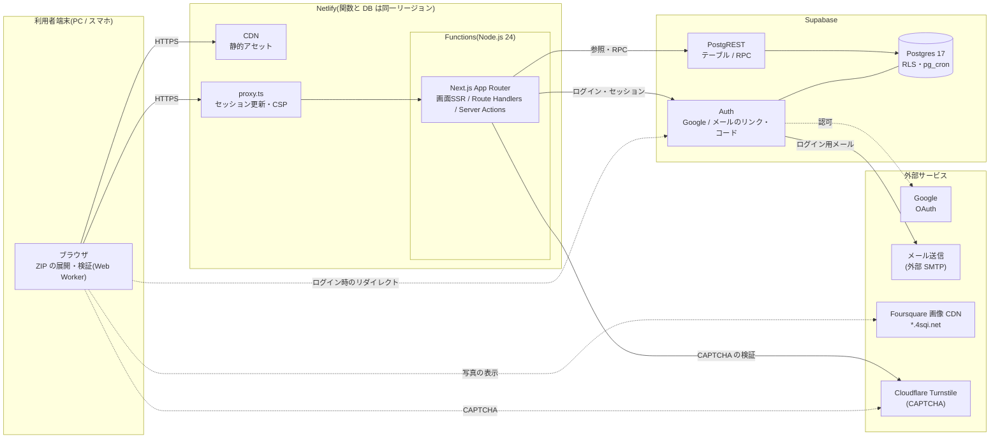

# 2. システム概要

> [基本設計書 目次](README.md) ｜ 前: [1. 前提条件・決定済み事項](01_前提条件.md) ｜ 次: [3. 技術調査の結果と方式決定](03_調査結果と方式決定.md)

---

## 2.1 システム構成

## 2.2 構成要素と責務

| 構成要素 | 責務 | 備考 |
|---|---|---|
| ブラウザ | 画面の表示と入力。エクスポート ZIP の展開・必要なファイルの抽出・検証を Web Worker で行い、チェックインを分割して送信する。写真を Foursquare の画像 CDN から直接表示する | ZIP そのものや不要なファイルはサーバーに送らない |
| Netlify CDN | 静的アセットの配信 | |
| proxy.ts | (1) セッションのリフレッシュ(9.1.3)、(2) 未ログイン時のリダイレクト、(3) CSP の nonce 付与、の3つだけを行う。DB には問い合わせない。リフレッシュのために secret key を持つ(Auth API だけに使う) | Next.js 16 の Proxy(Next.js 上は Node.js ランタイム)。Netlify の文書では Edge Functions 上で実行される。動作は S-4 で確認。認可の判定はここに頼らない |
| Next.js アプリ | 画面の SSR、Route Handlers、Server Actions。ログインの開始と完了、CAPTCHA の検証、取り込みデータの検証と組み立て直し、検索式の解析、利用同意の確認 | Netlify Functions 上で実行 |
| Supabase Auth | Google ログイン、メールのワンタイムリンク・コード、セッション(JWT・リフレッシュトークン)の発行 | メールは外部 SMTP で送る(内蔵の SMTP はチームメンバー以外に送れないため) |
| Supabase Postgres | 業務データの保存、RLS、取り込み・検索・削除の DB 関数、レート制限、pg_cron(定期処理) | |
| 外部サービス | Google(OAuth)、外部 SMTP(例: Resend)、Cloudflare Turnstile(メールログインのボット対策)、Foursquare の画像 CDN(写真の表示のみ) | Foursquare API は使わない |

## 2.3 基本方針

| No | 方針 | 狙い・対応要件 |
|---|---|---|
| P-1 | ブラウザは、ログイン時のリダイレクト、CAPTCHA(Turnstile)、画像の表示を除き、Next.js サーバーとだけ通信する。Supabase へのデータアクセスはすべてサーバー側で行う | セッション Cookie を httpOnly にできる。キーをブラウザに渡さない |
| P-2 | データの読み書きはユーザークライアント(JWT)で行い、RLS と DB 関数で本人のデータに限る。DB 関数は利用者IDを JWT(`auth.uid()`)から決め、引数で受け取らない。管理クライアントは最小限の用途に限り、検証済み JWT の利用者IDで必ず絞り込む | N-01、最小権限 |
| P-3 | レート制限や定期処理などの横断機能は Postgres 側(関数・pg_cron)で実装し、ホスティング固有の機能に依存しない。未認証の入口(ログイン)は、CAPTCHA と Netlify のレート制限ルールを併用する | 移植性。Netlify のレート制限は IP 単位でしか数えられないため |
| P-4 | 長時間処理を作らない。**どの関数も1リクエスト10秒以内**に収める。取り込みは小さな塊に分けてブラウザが順に送る | 関数のタイムアウト・リクエストサイズ(6MB)の回避、F-11 |
| P-5 | 必要最小限のデータだけを受け取る。ZIP の展開と抽出はブラウザで行い、チェックインと写真の情報以外(友人一覧、支払い・端末情報、訪問履歴、写真の実ファイルなど)は送らない。サーバーは受け取ったレコードから、許可した項目だけで raw を組み立て直す | プライバシー(N-11) |
| P-6 | raw を保存し、検索・表示用の列はいつでも raw から作り直せるようにする。エクスポートの形式は公式に文書化されておらず予告なく変わりうるため、取り込み処理は欠損や形の揺れを前提に書き、形式の判定と変換を1か所にまとめる | N-06 |
| P-7 | 検索式は構造(中間AST)だけを DB に渡す。SQL は DB 関数の中で固定の部品から組み立て、語は必ずバインド変数で渡す | N-10 |
| P-8 | アップロードされたデータは信用しない。サーバーと DB 関数で形式・長さ・範囲・件数を検証し、画面ではすべてテキストとして表示する。URL はアップロードされた値をそのまま使わず、検証した ID や許可したパターンから組み立てる | 不正データ・XSS の防止 |
| P-9 | プラットフォーム固有の SDK を使わない。設定は環境変数で読む。クライアントはリクエストごとに作り、グローバルな状態を持たない。利用者固有のデータはキャッシュしない(`Cache-Control: private, no-store`) | 移植性、情報漏えいの防止 |
