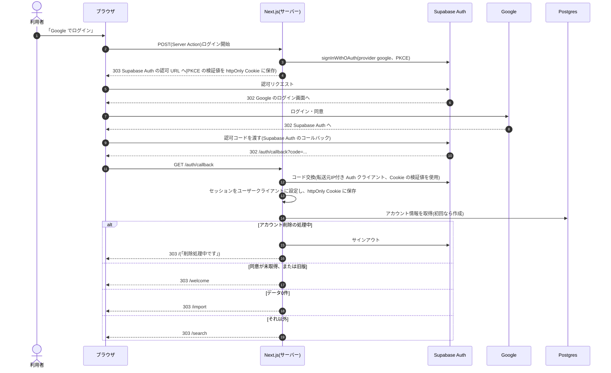
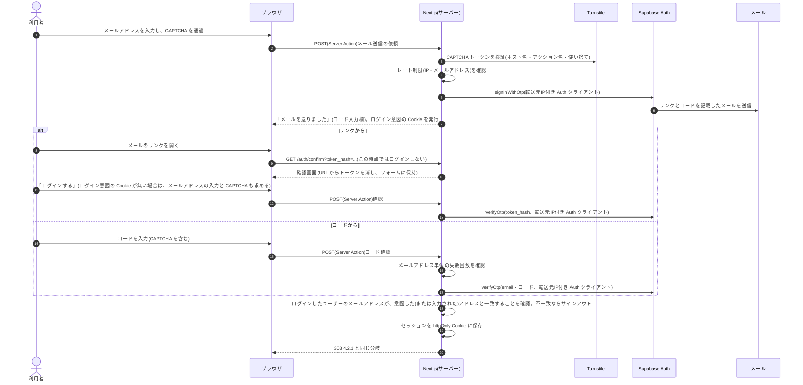
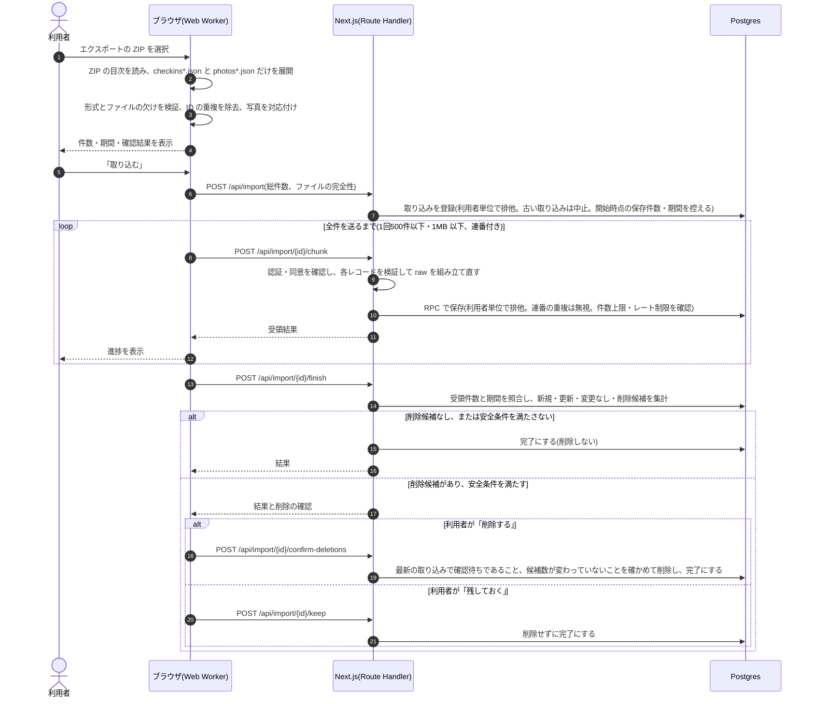
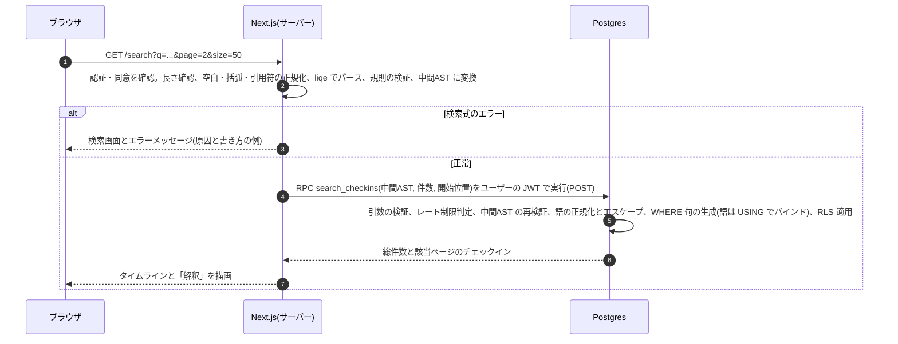
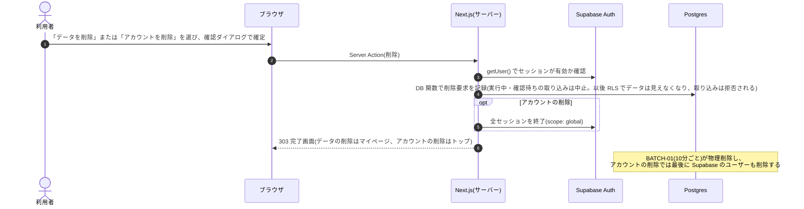

# 4. 機能設計

> [基本設計書 目次](README.md) ｜ 前: [3. 技術調査の結果と方式決定](03_調査結果と方式決定.md) ｜ 次: [5. 画面設計](05_画面設計.md)

---

## 4.1 機能一覧

| 機能ID | 機能名 | 概要 | 起動契機 | 対応要件 |
|---|---|---|---|---|
| AUTH-01 | Google ログイン | Supabase Auth の PKCE フローで Google にリダイレクトし、戻りでセッションを確立する | トップの「Google でログイン」 | F-01, N-08 |
| AUTH-02 | メールでログイン | メールアドレスと CAPTCHA を受け取り、ワンタイムリンクとコードをメールで送る。リンクを開いて確認ボタンを押すか、コードを入力するとログインする | トップの「メールでログイン」 | F-01 |
| AUTH-03 | ログアウト | この端末のセッションだけを終了する | ヘッダー/マイページ | F-05 |
| AUTH-04 | すべての端末からログアウト | 全セッションを終了する | マイページ | 【提案】 |
| AUTH-05 | セッション維持・認可ガード | リクエストごとにセッションを更新し、未ログインならトップへ誘導する。各画面・各処理の中で認証と同意を確認する(9.1.5) | 全リクエスト | N-01 |
| CONS-01 | 利用同意 | 初回ログイン時に、取り込むデータ(位置情報を含む)の扱い・保存場所・削除方法・委託先を示して同意を得る。同意するまで取り込めない。同意文面を改訂したら再同意を求める | 初回ログイン後、同意文面の改訂後 | N-11【提案】 |
| IMPT-01 | エクスポートの申請案内 | エクスポートの申請手順(Swarm アプリ・Web)と、届くまでの目安を案内する | 取り込み画面、データ0件時 | F-16 |
| IMPT-02 | ファイルの読み込み | 利用者が選んだ ZIP(または展開済みの JSON)から、ブラウザ側で `checkins*.json` と `photos*.json` だけを取り出し、形式とファイルの欠けを検証して件数・期間を表示する | 取り込み画面でファイルを選択 | F-10, N-11 |
| IMPT-03 | 分割送信と保存 | チェックインレコードを連番付きの小さな塊に分けて送り、サーバーで検証・組み立て直しを行って保存する。進捗を表示する | 「取り込む」ボタン | F-10, F-11, F-13 |
| IMPT-04 | 取り込みの完了と差分の確定 | 件数と期間を照合し、新規・更新・変更なし・削除候補の件数を表示する。削除候補は、安全条件を満たす場合だけ利用者に確認したうえで削除する | 送信完了後 | F-12 |
| IMPT-05 | 取り込みエラー処理 | 形式の不一致・送信失敗などの原因と対処を表示し、やり直せるようにする | 取り込み中のエラー | F-14 |
| SRCH-01 | チェックイン検索 | 検索式を解析・検証し、DB 関数で検索する。総件数と表示ページ分のデータを返す | 検索画面での検索・ページ移動 | F-20〜F-26, N-03, N-05, N-10 |
| SRCH-02 | 検索結果表示 | タイムライン表示、件数表示、ページネーション、該当なし表示、検索条件の解釈表示 | 検索結果の受信 | F-24, F-30, F-31 |
| DETL-01 | チェックイン詳細 | 保存データ(写真を含む)を表示し、Foursquare 上の店ページへのリンクを示す | 一覧の1件をクリック | F-33 |
| ACCT-01 | 取り込み状況の表示 | 保存件数、最新チェックインの日時、最終取り込み日時を表示する | マイページ、ヘッダー | F-04 |
| ACCT-02 | データの削除 | 取り込んだデータをすべて削除する(アカウントは残す) | マイページ | F-03, F-40 |
| ACCT-03 | アカウントの削除 | データとアカウントを削除する | マイページ | F-03, F-40 |
| BATCH-01 | 削除処理と後始末 | 削除要求されたデータ・アカウントの物理削除、放棄された取り込みの後始末、不要になったアカウントと補助データの削除(9.5) | 10分ごと(pg_cron) | F-42 |
| DEV-01 | ローカル開発環境・シード | Supabase CLI のローカルスタック、マスク済みエクスポートの fixture | 開発者の操作 | L-01〜L-05 |

## 4.2 処理の流れ

### 4.2.1 Google ログイン — AUTH-01

### 4.2.2 メールでログイン — AUTH-02

- リンクを開いただけではログインしない。メールのセキュリティ製品がリンクを先読みしてワンタイムトークンを消費する問題を避けるため。
- **他人から転送されたリンクでのログインを防ぐ**: 送信時に、メールアドレスのハッシュに紐づく短命の httpOnly Cookie(ログイン意図)を発行する。確認時にこの Cookie が無い場合(別のブラウザで開いた場合など)は、利用者にメールアドレスを入力してもらい、ログインしたユーザーのアドレスと一致しなければ即座にサインアウトする。攻撃者が自分宛のリンクを転送して、被害者を攻撃者のアカウントにログインさせ、被害者のデータを取り込ませる攻撃への対策。あわせて、利用同意・取り込みの画面に「xxx@… のアカウントに取り込みます」と表示する。
- コードの桁数は Supabase の設定値に従い、画面で桁数を固定しない。コードの有効期限は10分以下にする。
- 送信の結果は、アドレスが登録済みかどうかにかかわらず同じ表示にする。

### 4.2.3 エクスポートの取り込み — IMPT-01〜05

### 4.2.4 検索 — SRCH-01 / SRCH-02

### 4.2.5 データ・アカウントの削除 — ACCT-02 / ACCT-03 / BATCH-01

