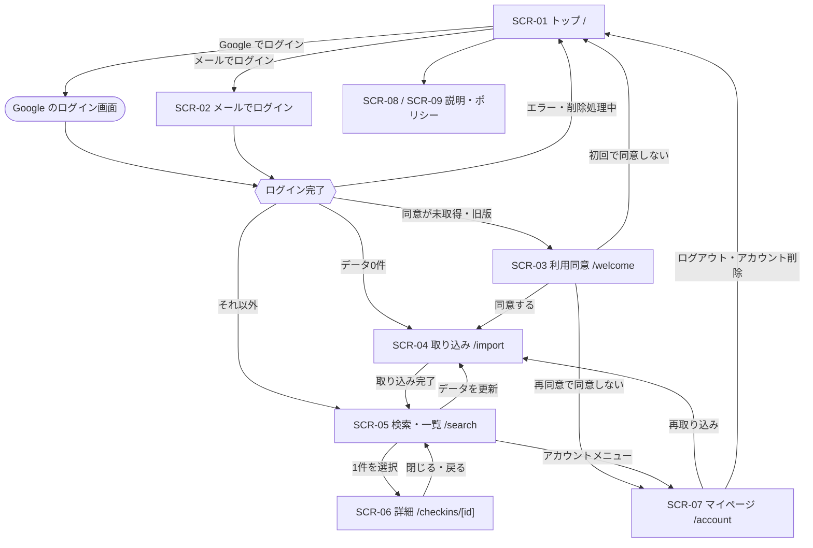

# 5. 画面設計

> [基本設計書 目次](README.md) ｜ 前: [4. 機能設計](04_機能設計.md) ｜ 次: [6. データ設計](06_データ設計.md)

---

## 5.1 画面一覧

| 画面ID | 画面名 | URL | ログイン | 概要 | 主な機能 |
|---|---|---|---|---|---|
| SCR-01 | トップ | `/` | 不要 | アプリの説明、Google でログイン、メールでログイン。ログイン済みなら `/search` へ | AUTH-01, AUTH-02 |
| SCR-02 | メールでログイン | `/login/email`、`/auth/confirm` | 不要 | メールアドレスの入力、CAPTCHA、送信後のコード入力。リンクから開いた場合の確認画面 | AUTH-02 |
| SCR-03 | 利用同意 | `/welcome` | 要 | 取り込むデータの扱い、保存場所、委託先、削除方法を示し、同意を得る | CONS-01 |
| SCR-04 | 取り込み | `/import` | 要・同意 | エクスポートの申請案内、ファイル選択、確認、進捗、結果(削除候補の確認) | IMPT-01〜05 |
| SCR-05 | 検索・一覧 | `/search` | 要・同意 | 検索ボックス、解釈、件数、タイムライン、ページネーション | SRCH-01, SRCH-02 |
| SCR-06 | チェックイン詳細 | `/checkins/[id]` | 要・同意 | 保存データと写真。一覧からはシート表示、直接アクセス時は単独ページ | DETL-01 |
| SCR-07 | マイページ | `/account` | 要(同意は不要) | 取り込み状況、再取り込み、ログアウト、すべての端末からログアウト、データ削除、アカウント削除 | ACCT-01〜03, AUTH-03, AUTH-04 |
| SCR-08 | このアプリについて | `/about` | 不要 | 非公式アプリである旨と商標の免責文、使い方、できること・できないこと、よくある質問 | — |
| SCR-09 | プライバシーポリシー・利用規約 | `/privacy`、`/terms` | 不要 | 9.5 に挙げる必須記載事項 | N-11 |
| SCR-E | エラー・処理中 | 各画面 | — | ログインのエラー、削除処理中、404、500 | — |

## 5.2 画面遷移



- 未ログインで保護画面にアクセスした場合はトップへリダイレクトする(proxy.ts)。同意の確認は各画面・各処理で行う(9.1.5)。
- 初回の同意で「同意しない」を選んだ場合は、何も保存していないため、アカウントを即時に削除してトップに戻る。同意文面の改訂後の再同意で「同意しない」を選んだ場合は、データを削除せず、マイページ(データの削除・アカウントの削除・ログアウトだけができる)に移る。

## 5.3 共通レイアウト

| 領域 | 内容 |
|---|---|
| ヘッダー | アプリ名(`/search` へのリンク)、データの鮮度(「最新チェックイン 10/14・取り込み 10/16」)と「データを更新」リンク、アカウントメニュー(マイページ・ログアウト)。未ログイン時はアプリ名のみ |
| メイン | 1カラム。本文の最大幅は約 768px |
| フッター | 非公式アプリである旨と商標の免責文、このアプリについて・プライバシーポリシー・利用規約へのリンク |
| レスポンシブ | スマホ優先で設計。ブレークポイントは sm 640px / md 768px / lg 1024px(Tailwind 標準) |

## 5.4 画面別の概要

以下のワイヤーフレームは配置のイメージであり、寸法や文言は詳細設計で確定する。

### SCR-01 トップ

```text
[ロゴ] Ashiato
-----------------------------------------------------------
  Swarm のチェックイン履歴を、
  店名やコメントで検索できます。

  [ Google でログイン ]
  [ メールでログイン ]

  使い方
  1. Swarm の設定から、データのダウンロードを申請します
     (数日でメールが届きます)
  2. 届いた ZIP ファイルを、このアプリで読み込みます
  3. 店名・コメントで検索できます

  できないこと: 住所・カテゴリでの検索、自動での更新
  ・保存するデータと削除方法
-----------------------------------------------------------
このアプリについて | プライバシー | 利用規約
本アプリは Foursquare / Swarm の公式アプリではありません
```

### SCR-02 メールでログイン

```text
メールでログイン
  メールアドレス [                         ]
  [CAPTCHA]
  [ ログイン用のメールを送る ]

(送信後)
メールを送りました。メールのリンクを開くか、
記載のコードを入力してください(10分以内)。
  コード [        ]  [CAPTCHA]  [ ログイン ]
  メールが届かない場合: 迷惑メールフォルダを確認 / 再送(60秒後)

(/auth/confirm をリンクから開いた場合)
  [ ログインする ]
  (別のブラウザで開いた場合)
  確認のため、メールアドレスを入力してください [            ] [CAPTCHA]
```

### SCR-03 利用同意

```text
はじめに確認してください(xxx@example.com でログイン中)

このアプリは、あなたがアップロードした Foursquare / Swarm の
データエクスポートから、次のデータを保存して検索に使います。
・チェックインの日時・店名・コメント・公開範囲・写真の情報
  ※ 位置情報(どこにいたか)を含みます
・友人一覧・支払い・端末の情報などは読み込みません(送信もしません)

・データはあなただけが閲覧でき、第三者に提供しません
・保存場所: (Supabase のリージョン。例: 米国)
・委託先: Supabase(DB・認証)、Netlify(配信)、メール送信、Cloudflare(CAPTCHA)、Google(ログイン)
・データはいつでも削除できます(マイページ)
・詳しくは プライバシーポリシー / 利用規約

[ 同意してはじめる ]   [ 同意しない ]
```

### SCR-04 取り込み

```text
データの取り込み(xxx@example.com のアカウントに取り込みます)

1. エクスポートを申請する(まだの場合)
   Swarm アプリ: プロフィール → 設定 → プライバシー設定
     → 「Initiate Data Download Request」
   Web: foursquare.com → Settings → Privacy Settings → 同上
   通常2〜3日(最大7日)で、ダウンロード用のリンクがメールで届きます。

2. 届いた ZIP ファイルを選ぶ
   [ ファイルを選択 ]  (ZIP のまま選べます。写真が入っていて大きくても大丈夫です)

(読み込み後)
   チェックイン 14,265 件(2011/04/02 〜 2026/10/14)
   写真の情報 3,120 件
   ※ 友人一覧・支払い・端末の情報などは送信しません
   [ 取り込む ]

(取り込み中)
   [■■■■■■■■■■■□□□□□□□]  58%   8,250 / 14,265 件

(完了)
   新規 120 件 / 更新 3 件 / 変更なし 14,142 件
   今回のエクスポートに含まれていない 2 件があります(Swarm で削除された可能性)。
   [ 削除する ]  [ 残しておく ]
   [ 検索をはじめる ]

(削除処理中の場合)
   データの削除を処理しています(通常1時間以内に完了します)。完了するまで取り込めません。
```

### SCR-05 検索・一覧(PC)

```text
[ロゴ] Ashiato        最新チェックイン 10/14・取り込み 10/16 [データを更新]  (メニュー)▼
-------------------------------------------------------------------------------
 [ 一蘭 OR (ラーメン 渋谷)                               ] [検索] [?]
 解釈: 一蘭 OR (ラーメン AND 渋谷)
 1,234件中 51–100件                                           表示件数 [50▼]

 2026年10月
  ● 10/14(火) 19:32
  │  一蘭 渋谷店                                                   写真 2枚
  │  「替え玉2回」
  │
  ● 10/12(日) 12:05                                               親しい友達
  │  ブルーボトルコーヒー 渋谷カフェ
  │
 2026年9月
  ● 09/30(火) 08:10
     JR 渋谷駅

                    ‹ 前へ   1 … 4 [5] 6 … 25   次へ ›
-------------------------------------------------------------------------------
 このアプリについて | プライバシー
```

### SCR-05 検索・一覧(スマホ)

```text
[ロゴ]          [更新] (メニュー)
[ 一蘭 OR (ラーメン 渋谷) ] [検索]
1,234件(51–100件)        [50▼]

2026年10月
● 10/14(火) 19:32
│ 一蘭 渋谷店 · 写真 2枚
│ 「替え玉2回」
│
● 10/12(日) 12:05
│ ブルーボトルコーヒー 渋谷カフェ

        ‹    5 / 25    ›
```

| 表示項目(1件) | 内容 | 要件 |
|---|---|---|
| 日時 | 現地時刻の「MM/DD(曜) HH:mm」。年は月見出しに表示 | F-30 |
| 店名 | venue の名前。venue が無い場合は場所名、イベントならイベント名、それも無ければ「(場所なし)」 | F-30 |
| コメント(shout) | 2行で省略 | F-30 |
| 写真枚数 | 1枚以上のときだけ「写真 n枚」を表示 | F-30 |
| 公開範囲 | 「非公開」「親しい友達」のときだけ小さく表示 | F-30 |

- 月見出しは、ページ内で連続する同じ「年月」(現地時刻基準)ごとに付ける。タイムゾーンの違いで同じ月が離れて現れた場合は、見出しを重ねて表示する。
- 状態ごとの表示: 読み込み中はスケルトン。該当なし(F-31)は「『〇〇』に一致するチェックインはありませんでした」と検索のヒント(店名とコメントだけが検索対象であることも示す)。検索式のエラーは検索ボックス直下に、原因と正しい書き方の例を表示する。データ0件は取り込みへの誘導。最終取り込みから30日以上たっている場合は、エクスポートの再申請を促す控えめな案内を出す。
- 「?」ボタンで検索構文のヘルプ(9.3.1 の表と例)を表示する。
- 一覧の各リンクは先読み(prefetch)しない。

### SCR-06 チェックイン詳細

```text
(PC: 一覧の右側にシート / スマホ: 全画面)
✕ 閉じる
一蘭 渋谷店
2026年10月14日(火) 19:32(現地時刻 UTC+9)
「替え玉2回」
[写真] [写真]
公開範囲: 公開 · コメント 1件
Foursquare で店を見る ↗
```

- 保存データだけで表示する(外部 API は呼ばない)。
- 写真は、検証済みの画像 URL(9.4)を `` で表示する。表示できない場合(非公開写真など)は代わりの表示にする。
- 「Foursquare で店を見る」は、検証済みの venue ID から `https://foursquare.com/v/{venue_id}` を組み立てたリンク(アップロードされた URL はそのまま使わない)。住所やカテゴリはリンク先で確認してもらう。
- 一覧から開いた場合は URL を `/checkins/[id]` に変え、閉じる(または戻る)と一覧の同じスクロール位置に戻る。

### SCR-07 マイページ

```text
マイページ

アカウント
  ログイン中: xxx@gmail.com(Google)

データ
  保存件数 14,265 件
  最新チェックイン 2026/10/14 / 最終取り込み 2026/10/16
  [ データを更新する(エクスポートを再アップロード) ]

この端末
  [ ログアウト ]  [ すべての端末からログアウト ]

データの削除
  [ 取り込んだデータをすべて削除 ]  → 確認ダイアログ
  [ アカウントを削除 ]              → 確認ダイアログ
  ※ 削除したデータは元に戻せません(エクスポートを再アップロードすれば再び取り込めます)
```

## 5.5 UI デザイン方針(タイムライン型)

| 項目 | 方針 |
|---|---|
| コンセプト | 「自分の足跡をたどる日記」。縦のタイムラインで時間の流れを、軽い区切りで1件ずつを見せる |
| レイアウト | 1カラム中心。詳細は PC では一覧を残したまま右側のシートで、スマホでは全画面で表示する |
| 配色 | ニュートラル(グレー系)とアクセント1色(暖色のオレンジ系)。Swarm/Foursquare のロゴやブランドカラーは使わず、非公式アプリであることを明確にする |
| ダークモード | OS の設定に追従する(CSS の `prefers-color-scheme`)。手動切替は MVP では設けない |
| 文字 | Web フォントは使わず、システムフォントを使う。指定順は Hiragino Sans、Hiragino Kaku Gothic ProN、Noto Sans JP、Noto Sans CJK JP、Meiryo、sans-serif(`system-ui` は先頭にしない)。本文 16px 相当 |
| アイコン | lucide-react |
| コンポーネント | shadcn/ui(既定の Base UI 版)を使い、独自 CSS を最小限にする。通知は Base UI 版の toast |
| 状態表現 | 読み込み中はスケルトン、処理中のボタンはスピナー付きで無効化、完了通知はトースト、エラーはその場にインライン表示 |
| アクセシビリティ | WCAG 2.2 AA 相当を目標。コントラスト比 4.5:1 以上、キーボード操作、フォーカスの可視化、件数・取り込み進捗の読み上げ(aria-live)、ページネーションの `aria-current`。意味を持つアイコンにはラベルを付ける |
| 文言 | です・ます調で短く具体的に。エラーは「何が起きたか」と「どうすればよいか」をセットで示す |
| アップロード由来の値 | 店名・コメント(shout)などは、すべてテキストとして表示する。HTML として挿入しない。リンクや画像の URL はアップロードされた値をそのまま使わず、検証した ID や許可したパターンから組み立てる(9.4) |

## 5.6 ページネーション方針

| 項目 | 方針 |
|---|---|
| 方式 | ページ番号式(LIMIT/OFFSET + 総件数)【決定】。総件数の表示(F-31)と、任意のページへの移動を優先する |
| URL | `/search?q={検索式}&page={ページ番号}&size={表示件数}`。検索式を変えたら page=1 に戻す。戻る/進む・ブックマーク・再読み込みで同じ結果を再現する |
| 検索の送信 | 明示的な送信(Enter または検索ボタン)のみ。入力中の自動検索はしない |
| 表示件数 | 20 / 50(既定) / 100 |
| ページ番号の表示 | PC は「‹ 前へ 1 … 4 [5] 6 … 25 次へ ›」(最大7枠)、スマホは「‹ 5 / 25 ›」 |
| 範囲外の指定 | 最終ページに補正する(0件なら1ページ目)。不正な値は既定値にする |
| 件数表示 | 「1,234件中 51–100件」 |
| ページ移動時 | 一覧の先頭へスクロールする。ページ移動リンクは先読みしない |
| 並び順 | 日時の降順で固定(F-24)。同時刻は ID の降順で並べ、ページ間で順序が揺れないようにする |
