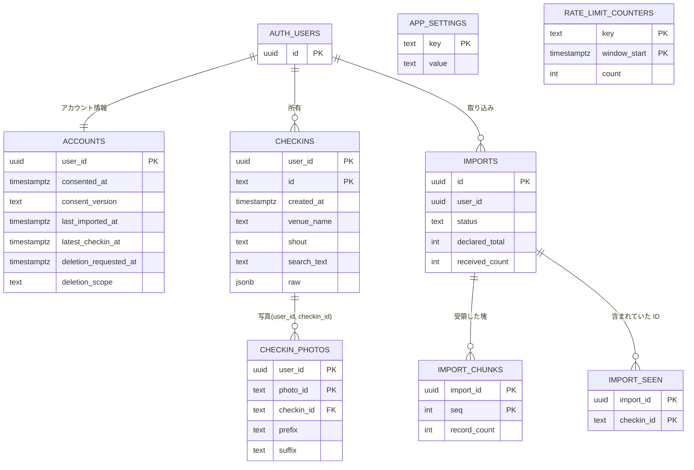
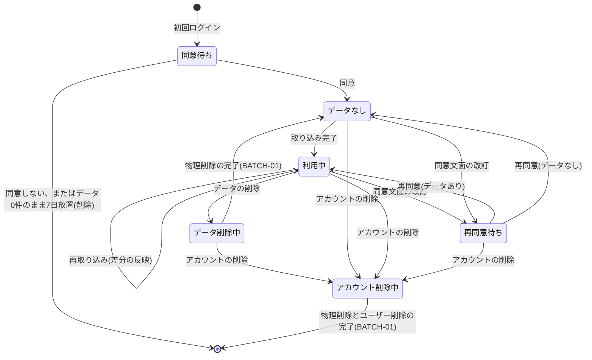

# 6. データ設計

> [基本設計書 目次](README.md) ｜ 前: [5. 画面設計](05_画面設計.md) ｜ 次: [7. インタフェース設計](07_インタフェース設計.md)

---

物理設計(型・インデックス・制約の最終値)は詳細設計書で確定する。

## 6.1 ER 図

## 6.2 テーブル一覧

| テーブル | スキーマ | 概要 | ユーザークライアントからの操作 |
|---|---|---|---|
| `users` | auth | ユーザー(Supabase 管理) | なし |
| `accounts` | public | 利用同意、取り込み状況、削除要求(1ユーザー1件) | 自分の行の参照。更新は DB 関数経由 |
| `checkins` | public | チェックイン(検索・一覧・詳細用、raw を含む) | 自分の行の参照(削除要求中を除く)。書き込みは DB 関数経由 |
| `checkin_photos` | public | チェックインに付いた写真の情報 | 同上 |
| `imports` | public | 取り込みの記録(状態・件数・期間) | 自分の行の参照。書き込みは DB 関数経由 |
| `app_settings` | public | 現在の同意文面の版、各種上限値などの設定 | 参照のみ(機微な値は置かない) |
| `import_chunks` | private | 取り込みで受領した塊の連番(再送の冪等化) | なし |
| `import_seen` | private | 取り込みに含まれていたチェックインID(削除候補の判定) | なし |
| `rate_limit_counters` | private | レート制限のカウンタ | なし |

private スキーマは Data API に公開しない。要件定義書5章のデータモデルからの変更は、要件変更一覧 3.9 を参照。

## 6.3 主要テーブルの論理項目

### accounts(アカウント情報)

| 項目 | 内容 |
|---|---|
| user_id | PK(auth.users 参照、ユーザー削除で連鎖削除)。初回ログイン時に作る |
| consented_at, consent_version | 利用同意の日時と同意した文面の版。現在の版は `app_settings` に置き、古い版なら再同意を求める |
| last_imported_at | 最後に取り込みが完了した日時(取り込みが completed になった時点で更新) |
| latest_checkin_at | 保存済みの最新チェックインの日時。取り込みの完了・削除の確定・データ削除の完了の各時点で、保存データから再計算する(0件なら NULL) |
| deletion_requested_at, deletion_scope | 削除の要求日時と範囲(data / account)。設定後は RLS でデータが見えなくなり、取り込みは拒否される。データ削除の処理中にアカウント削除を要求した場合は account に上書きする |
| created_at, updated_at | 作成・更新日時 |

### checkins(チェックイン)

| 項目 | 内容 | 抽出元(チェックインレコード) | 欠損・不正時 |
|---|---|---|---|
| user_id, id | ユーザーID + チェックインID(複合 PK) | id(24桁の16進数) | 取り込まない |
| created_at | チェックイン日時(UTC) | createdAt(UTC の文字列 `YYYY-MM-DD HH:MM:SS.ffffff`、または UNIX 秒の整数)。2009-01-01〜現在+1日の範囲 | 取り込まない |
| tz_offset | 現地時刻との差(分) | timeZoneOffset(−720〜840) | NULL(UTC で表示) |
| type | checkin / venueless / shout など | type | 'checkin' |
| visibility | 公開範囲(public / private / closeFriends など) | visibility(無ければ private:true → private) | NULL |
| shout | コメント | shout | NULL |
| venue_id, venue_name | venue の ID と名前 | venue.id(24桁の16進数)/ venue.name | NULL |
| location_name | 場所名(venue の無いチェックイン) | location.name | NULL |
| lat, lng | 緯度・経度(含まれている場合のみ) | location.lat/lng、またはトップレベルの lat/lng【暫定 S-1】。範囲を検証 | NULL |
| event_name | イベント名 | event.name | NULL |
| photo_count | 写真枚数 | DB 関数が checkin_photos から数える | 0 |
| comment_count | コメント数 | comments.count | 0 |
| raw | 許可した項目だけで組み立て直したチェックインレコード(2KB 以下) | — | 必須 |
| search_text | 検索用の正規化テキスト(生成列) | 店名・コメント(shout)・場所名・イベント名を連結し、NFKC 正規化と小文字化 | — |
| imported_at, updated_at | 最初に保存した日時、内容が変わって更新した日時 | — | — |

文字列の長さには上限を設け(店名・場所名・イベント名 500文字、コメント 2,000文字など。値は詳細設計で確定)、超えるレコードは切り詰めずに不正として扱う。DB にも長さとサイズの制約を付ける。

### checkin_photos(写真の情報)

| 項目 | 内容 |
|---|---|
| user_id, photo_id | PK |
| checkin_id | 対応するチェックイン((user_id, checkin_id) で checkins を参照し、連鎖削除)。写真情報の relatedItemUrl の末尾から取り出す。チェックインに対応しない写真は取り込まない |
| prefix, suffix, width, height | 画像 URL の組み立てに使う値。prefix と suffix は許可したパターン(9.4)に一致するものだけを保存する |
| visibility, created_at | 公開範囲、撮影・投稿日時 |

写真は、取り込んだチェックインごとに今回の集合で置き換える(既存の写真の行を削除して入れ直す)。Swarm で削除された写真が残らないようにするため。

### imports(取り込みの記録)

| 項目 | 内容 |
|---|---|
| id | PK |
| user_id | ユーザーID |
| status | uploading(送信中) / awaiting_confirmation(削除候補の確認待ち) / completed / failed / cancelled |
| source_complete | ブラウザが確認したファイルの完全性(ZIP から読み、`checkins` の連番に欠番が無く、各ファイルの件数が一致した) |
| declared_total | ブラウザが ID の重複を除いたうえで申告したチェックインの総件数。開始時に保存件数の上限と照合する |
| received_count | サーバーが数えた、受領した一意の ID の数(`import_seen` の件数) |
| inserted_count, updated_count, unchanged_count, rejected_count | 新規、内容が変わって更新、変更なし、不正で保存しなかった件数 |
| period_min, period_max | 受領したレコードから、サーバーが算出したエクスポートの期間 |
| baseline_count, baseline_min, baseline_max | 開始時点で保存済みだった件数と期間 |
| delete_candidate_count, deleted_count | 削除候補の件数と、実際に削除した件数 |
| file_summary | 読み込んだファイル名と件数(内容は保存しない) |
| started_at, finished_at | 開始・終了日時 |

取り込みの記録は90日で削除する(データ削除時にも削除する)。

### import_chunks・import_seen(private スキーマ)

| テーブル | 項目 | 内容 |
|---|---|---|
| import_chunks | import_id, seq, record_count | 受領済みの塊の連番。同じ連番の再送は保存せず、前回の結果を返す |
| import_seen | import_id, checkin_id | 今回の取り込みに含まれていた ID。保存できなかったレコード(ID は正しいが内容が不正)の ID も入れ、削除候補から外す。取り込みの終了後に削除する |

### app_settings(設定)

| キーの例 | 内容 |
|---|---|
| consent_version | 現在の同意文面の版 |
| max_checkins_per_user | 1利用者の保存件数の上限(20万) |
| delete_candidate_limit | 削除候補を提示する上限(保存件数の5% と 20件の大きい方) |

上限値は DB の設定表を正とし、Next.js は表示などのために読むだけにする。

### rate_limit_counters(private スキーマ)

| 項目 | 内容 |
|---|---|
| key | 制限対象のキー。IP アドレスとメールアドレスは、サーバーの秘密鍵による HMAC で仮名化して使う(例: `search:{user_id}`、`import:{user_id}`、`login_ip:{IP の HMAC}`、`login_email:{アドレスの HMAC}`) |
| window_start | 固定ウィンドウの開始時刻 |
| count | ウィンドウ内の回数 |

## 6.4 データのライフサイクル

## 6.5 アクセス制御

| 対象 | anon | authenticated(ユーザークライアント) | service_role |
|---|---|---|---|
| accounts | 不可 | 自分の行の SELECT | 全操作 |
| checkins、checkin_photos | 不可 | 自分の行の SELECT(削除要求中を除く) | 全操作 |
| imports | 不可 | 自分の行の SELECT | 全操作 |
| app_settings | 不可 | SELECT | 全操作 |
| private スキーマのテーブル | 不可 | 不可 | 全操作 |
| RPC 検索関数 | 不可 | 実行可(呼び出し元の権限で実行し、RLS を適用) | — |
| RPC 取り込み・同意・削除要求の関数(public の薄い関数 → private の所有者権限の関数) | 不可 | 実行可(利用者IDは関数の中で `auth.uid()` から決め、引数で受け取らない) | — |
| RPC レート制限判定(同上) | 不可 | 実行可(利用者単位のキーは関数の中で `auth.uid()` から作る) | 実行可(未認証の入口の判定用。IP・アドレスの HMAC をキーとして渡す) |

- RLS の条件は `user_id = (select auth.uid())`(要件定義書5章)。`(select …)` で包み、行ごとの評価を避ける。checkins と checkin_photos には「削除要求中でないこと」の条件を加える。
- **すべてのテーブルで RLS を有効にする**。ユーザークライアントにはテーブルへの INSERT・UPDATE・DELETE の権限を与えず、書き込みは件数・サイズ・頻度の上限を強制する DB 関数だけで行う(N-12)。
- 書き込みを伴う DB 関数(取り込み・同意・削除要求)は、`accounts` の行をロックして利用者単位で直列化し、同意済みであること・削除要求中でないことを関数の中で確かめる。
- Supabase の Data API は、新規プロジェクトでは 2026-05-30 から、既存プロジェクトでは 2026-10-30 から、新規テーブルを自動で公開しなくなった。**すべてのテーブルの GRANT と、すべての関数の EXECUTE の権限をマイグレーションに明記する**。関数の EXECUTE は関数ごとに `public, anon, authenticated` から外してから必要なロールにだけ付ける。private スキーマの関数を呼ぶためのスキーマの USAGE と EXECUTE も明記する。生成列が参照する補助関数は、書き込むロールに EXECUTE を付ける。所有者権限の関数は `search_path` を空に固定する。
- 権限の抜け漏れは pgTAP で検査する(public スキーマの全テーブル・全関数について、anon は権限なし、authenticated は許可リストどおりであること)。
- 管理クライアントは、サーバー専用モジュール(クライアントバンドルに含まれないことをビルド時に保証する仕組み)からだけ生成する。
